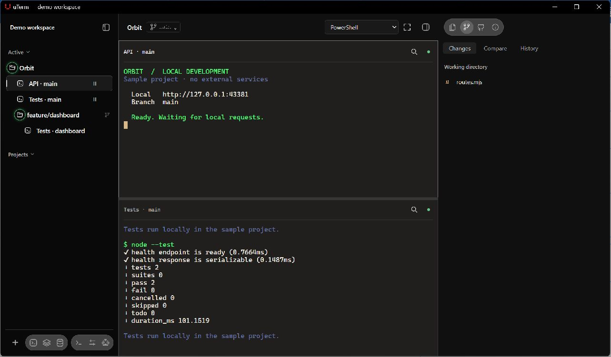
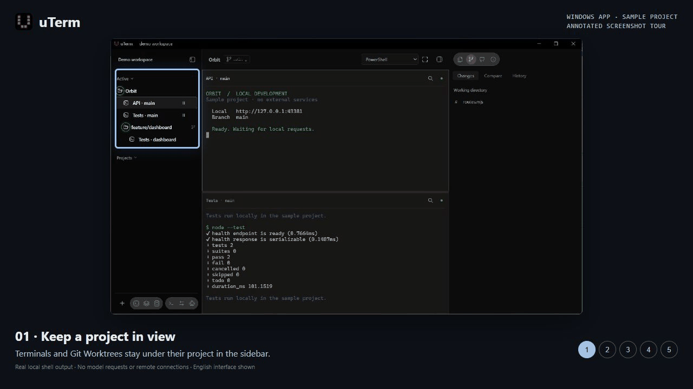

# uTerm

[简体中文](README.zh-CN.md) · [Website](https://yondfane.github.io/uTerm/?lang=en) ·
[Feature guide](docs/features.md) · [Releases](https://github.com/YondFane/uTerm/releases)

**A terminal workspace for coding agents, Git Worktrees and remote development on Windows and
macOS.**

Keep your terminals, agents and project tools together. Organize work by project, review Git changes
alongside your sessions, and reconnect to local processes after reopening the app.

[Download](#download) · [Quick start](#quick-start) · [Tour](#see-the-workflow) ·
[Features](#what-you-can-do) · [Command install](#one-line-installation) ·
[License](#license-and-feedback) · [Development](#development)



_The Windows app running a disposable sample project and real local shell sessions._

## Download

| Platform            | Stable installer                                                                 |
| ------------------- | -------------------------------------------------------------------------------- |
| Windows x64         | [Download for Windows](https://yondfane.github.io/uTerm/?lang=en#download)       |
| macOS Apple Silicon | [Download for Apple Silicon](https://yondfane.github.io/uTerm/?lang=en#download) |
| macOS Intel         | [Download for Intel](https://yondfane.github.io/uTerm/?lang=en#download)         |

The website resolves the matching installers from the latest stable release. If it cannot load
release metadata, use [GitHub Releases](https://github.com/YondFane/uTerm/releases/latest) and
choose your platform. Downloading a desktop installer needs no Node.js or Rust.

macOS builds are not Apple-notarized; first launch may require approval in **System Settings →
Privacy & Security**. Windows uses its installation wizard. Downloads require GitHub access.

## Quick start

1. Install and open uTerm, then choose **Add project** and select your project folder.
2. Open a terminal, or enable an installed Agent under **Settings → Agent** and start a chat from
   the project row. Each CLI uses its own authentication.
3. Right-click a session and choose **Group with …** to place sessions side by side. Open **Git** to
   review changes; existing Git Worktrees appear under their project.

Quitting detaches the window while local sessions keep running. Reopen to reconnect; **Close
Session** terminates the selected process.

Enable task notifications in **Settings → Agent**. Codex and OpenCode can report precise events
without Hooks; all Agents can forward their native terminal notifications or bells as general
reminders. See [notification sources and limits](docs/features.md#notifications-without-hooks).

## See the workflow

[Watch the 30-second screenshot tour](site/media/workflow.mp4)



The annotated tour uses an actual Windows app screenshot with a disposable sample project and real
local shell output. It is a screenshot tour, not a continuous screen recording; no model requests or
remote-server connections are shown. [Media details](site/media/README.md).

## What you can do

| Workflow                          | In uTerm                                                                                                                                                 |
| --------------------------------- | -------------------------------------------------------------------------------------------------------------------------------------------------------- |
| Work on several tasks             | Organize terminals and Agents by workspace, project and Git Worktree; split panes and see Agent activity through supported Hooks.                        |
| Keep project context nearby       | Review Git status, diffs and commits; edit files with conflict checks and draft recovery; preview Markdown and PDF.                                      |
| Work with remote systems and data | Use system OpenSSH for SSH/SFTP; browse Redis and query MySQL, PostgreSQL, Oracle, Elasticsearch or MongoDB with read-only defaults and guarded editing. |

The interface supports English and Simplified Chinese, six palettes, configurable fonts and keyboard
shortcuts. Agent programs are optional; install or configure the CLI you want to use. SQL and
MongoDB connections require Java 17+ and the selected drivers, managed on demand in the app.
Elasticsearch requires no additional runtime. See the [feature guide](docs/features.md) for
supported behavior, limits and platform acceptance.

Ctrl+- and Ctrl++ adjust the font of the visible terminal, Agent session or file content; macOS uses
Command instead of Ctrl. Session and file headers also offer font buttons. Session headers show the
starting directory, with Windows paths displayed from the drive letter. Right-click a Files → Quick
open result to copy the file, its name or path, or reveal it in the file manager.

Settings → Appearance → Sidebar style offers the default Classic sidebar and an Icon navigation
sidebar with a vertical icon rail beside the content list. Its Add button joins Commands, Settings
and Agent at the bottom of the rail. The choice saves immediately. Drag the sidebar edge to resize
it; narrow widths use compact actions and icons, with footer controls wrapping to stay accessible.
In navigation style, hiding or collapsing the sidebar keeps the icon rail visible; click a category
to reopen the content list. The Add menu starts with New terminal, then project and Agent actions,
before SSH, Redis and database connection actions. All three connection categories stay available in
navigation style, regardless of Classic sidebar visibility switches; switching back restores those
saved choices.

## One-line installation

macOS, in Terminal:

```sh
curl -fsSL https://raw.githubusercontent.com/YondFane/uTerm/release/scripts/install/install.sh | bash
```

Windows x64, in PowerShell:

```powershell
irm https://raw.githubusercontent.com/YondFane/uTerm/release/scripts/install/install.ps1 | iex
```

With Node.js 22.13 or newer, either package runner starts the same desktop installer:

```sh
npx @yondfane/uterm-install
# or / 或
pnpm dlx @yondfane/uterm-install
```

You can also install the command with `npm install -g @yondfane/uterm-install`, then run
`uterm-install`. Installing or removing the npm package manages the command only; it does not
install or uninstall the desktop app. Use `uterm-install --help` for options.

The macOS script installs to `~/Applications/uTerm.app` without sudo or launching the app. Existing
installations are preserved; use in-app updates. Installer downloads support bounded retries and
verified cache reuse when the stable feed provides size and SHA-256.
[Installer details](docs/features.md#one-line-installation).

## License and feedback

uTerm is source-available under the [PolyForm Noncommercial License 1.0.0](LICENSE), free for its
permitted uses. Commercial uses outside those already permitted require separate written
authorization; see [NOTICE](NOTICE) for terms and the authorization contact. Third-party components
retain their licenses.

[Report a bug or request a feature](https://github.com/YondFane/uTerm/issues/new). Include your OS,
uTerm version and the steps needed to reproduce the issue. If uTerm is useful to you, a star helps
other developers discover it.

## Development

Built with Tauri, React, TypeScript, Rust and xterm.js. Setup, commands, database component
development, validation and release instructions live in the
[development guide](docs/development.md). Follow [AGENTS.md](AGENTS.md) and the
[documentation writing rules](docs/writing-rules.md) when contributing.
