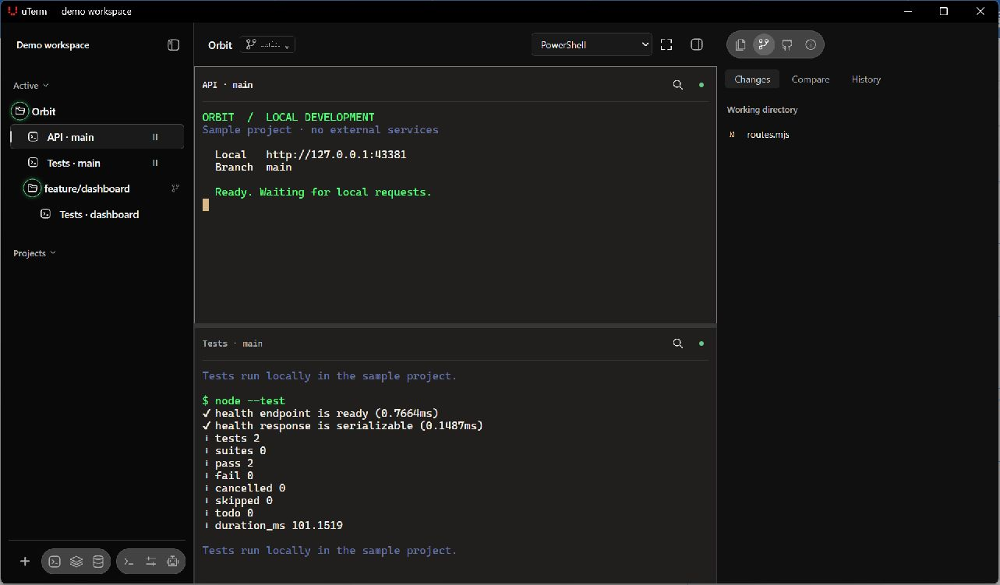

<p align="center">
  
</p>

# uTerm

**Your project. All together.**

A terminal workspace for coding agents, Git Worktrees and remote development on Windows and macOS.
Keep terminals, code, run tasks and data connections beside the project they belong to.

**[Download uTerm](https://yondfane.github.io/uTerm/?lang=en#download)** ·
[Explore the website](https://yondfane.github.io/uTerm/?lang=en) · [简体中文](README.zh-CN.md) ·
[Feature guide](docs/features.md)



_An actual Windows workspace with a disposable sample project and real local shell sessions._

[Download](#download) · [Quick start](#quick-start) · [Workflows](#what-you-can-do) ·
[Install commands](#one-line-installation) · [Development](#development) ·
[License & feedback](#license-and-feedback)

## Download

| Your device         | Installer                                                                  |
| ------------------- | -------------------------------------------------------------------------- |
| Windows x64         | [Windows · .exe](https://yondfane.github.io/uTerm/?lang=en#download)       |
| macOS Apple Silicon | [Apple Silicon · .dmg](https://yondfane.github.io/uTerm/?lang=en#download) |
| macOS Intel         | [Intel · .dmg](https://yondfane.github.io/uTerm/?lang=en#download)         |

The website finds the matching installers from the latest stable release. You can also choose an
installer on [GitHub Releases](https://github.com/YondFane/uTerm/releases/latest). Desktop
installers need no Node.js or Rust; downloads require GitHub access.

macOS builds are not Apple-notarized. First launch may require approval in **System Settings →
Privacy & Security**. On Windows, follow the installation wizard.

## Quick start

1. **Add your project.** Open uTerm, choose **Add project** and select a local folder. Existing Git
   Worktrees appear under their project.
2. **Open a session.** Start a terminal, or enable an installed Agent CLI in **Settings → Agent**.
   Right-click a session and choose **Group with …** to work in split panes. Each Agent CLI uses its
   own authentication.
3. **Run and review.** Open **Java build and run** or **Python run** from the project menu or
   toolbar. Review output in the bottom panel and inspect your changes in **Git**.

Quitting detaches the window while local sessions keep running. Reopen to reconnect; **Close
Session** terminates the selected process.

Agent installation, configuration, Hooks and notifications are in **Settings → Agent**. See
[Agent setup](docs/features.md#agents-and-settings), [TRAE CLI](docs/features.md#trae-cli) and
[notifications without Hooks](docs/features.md#notifications-without-hooks).

## What you can do

| Keep the work together | In uTerm                                                                                                |
| ---------------------- | ------------------------------------------------------------------------------------------------------- |
| **Projects & Agents**  | Organize terminals and Agents by workspace, project and Git Worktree. Split panes for parallel tasks.   |
| **Build & run**        | Build Java with Maven; run Java and Python projects with searchable logs and stop/restart controls.     |
| **Files & Git**        | Review diffs and commits, edit files with conflict checks and draft recovery, preview Markdown and PDF. |
| **Remote & data**      | Open SSH/SFTP, browse Redis, and query MySQL, PostgreSQL, Oracle, Elasticsearch and MongoDB.            |

**Java and Python keep their project context.** Switching projects brings the matching configuration
and logs. Right-click either toolbar icon to select a started task. Colored Java/Python icons in the
sidebar identify running projects.

- **Java:** Maven builds, Spring Boot development runs and JAR launches. Full JDK 8/11/17/21 and
  Maven tools install on demand. [Java and Maven guide](docs/features.md#java-and-maven-builds).
- **Python:** Scripts, modules, FastAPI, Flask and Django using your Python 3 or virtual
  environment. Prepare Python and project dependencies separately.
  [Python and logs guide](docs/features.md#python-projects-and-logs).

The interface supports English and Simplified Chinese, six palettes, configurable fonts and keyboard
shortcuts. Data tools default to read-only with guarded editing. SQL and MongoDB require Java 17+
and the selected drivers, managed on demand; Elasticsearch needs no additional runtime.

[Read the full feature guide](docs/features.md) for usage, limits and platform validation.

### See the workflow

[Open the five-step workspace tour](https://yondfane.github.io/uTerm/media/tour.html?lang=en) ·
[Watch the 30-second tour](site/media/workflow.mp4)

The tour annotates the actual Windows screenshot above. It is a screenshot tour rather than a
continuous recording, with no model requests or remote-server connections.
[Media details](site/media/README.md).

## One-line installation

macOS · Terminal:

```sh
curl -fsSL https://raw.githubusercontent.com/YondFane/uTerm/release/scripts/install/install.sh | bash
```

Windows x64 · PowerShell:

```powershell
irm https://raw.githubusercontent.com/YondFane/uTerm/release/scripts/install/install.ps1 | iex
```

With Node.js 22.13 or newer:

```sh
npx @yondfane/uterm-install
```

`pnpm dlx @yondfane/uterm-install` also starts the desktop installer. A global npm installation
manages the `uterm-install` command only, not the desktop app. Run `uterm-install --help` for
options.

The macOS script installs to `~/Applications/uTerm.app` without sudo or launching the app. Existing
installations are preserved; use in-app updates. Downloads support bounded retries and verified
cache reuse when the stable feed supplies size and SHA-256.
[Installer details](docs/features.md#one-line-installation).

## Development

Built with **Tauri · React · TypeScript · Rust · xterm.js**, with WebGL terminal rendering.

Start with the [development guide](docs/development.md) for setup, commands, repository layout,
validation and releases. Follow [AGENTS.md](AGENTS.md) and the
[documentation writing rules](docs/writing-rules.md) when contributing. Use the project's
Prettier/rustfmt and run `pnpm format` and `pnpm format:check` before committing.

## License and feedback

uTerm is source-available under the [PolyForm Noncommercial License 1.0.0](LICENSE), free for its
permitted uses. Commercial uses outside those already permitted require separate written
authorization; see [NOTICE](NOTICE) for terms and the authorization contact. Third-party components
retain their licenses.

[Report a bug or request a feature](https://github.com/YondFane/uTerm/issues/new). Include your OS,
uTerm version and steps to reproduce the issue.

Native macOS development is isolated from stable releases. See
[native migration](docs/native-migration.md) for the QA app, platform checks and staged feature
status.

Shared core checks: `pnpm test:core` and `pnpm contracts:check`. The shared Java task checks require
JDK 21 (`JAVA_HOME` and its `bin` on `PATH`); application builds still do not bundle or require a
JDK. `uterm-core::{java,python}` owns shared run configuration and task rules; Tauri provides
platform adapters and generated DTOs keep Swift/TypeScript boundaries aligned. Regenerate TS/Swift
boundary types with `pnpm contracts:generate`. On macOS, run `bash scripts/macos-native-build.sh`
and `bash scripts/macos-native-test.sh` for the isolated QA app and Rust/Swift bridge tests.

The embedded Java 8 encoding agent includes its Java source and reproducible runtime bytes. After
changing it, use JDK 21 to run `python3 scripts/java8-encoding-agent.py`, then
`python3 scripts/java8-encoding-agent.py --check`. Normal Rust/application builds need no Java
compiler; Windows interoperability CI checks the asset and runs the actual selected JDK.

Native terminal QA: `bash scripts/macos-terminal-smoke.sh` runs two real app processes with
temporary data, a bundled standalone helper and language/theme/width screenshot artifacts. It also
launches system Vim, enters and pastes Unicode through native terminal actions, verifies the saved
UTF-8 file and records the actual TUI window. This does not replace manual IME acceptance. SwiftPM
resolves the pinned SwiftTerm 1.20.0 dependency; it does not change the legacy terminal renderer.

Concurrent native ownership QA: `bash scripts/macos-input-control-smoke.sh` runs two isolated native
app processes against the same session, exercises the take-control button and passive input/resize
safeguards, and records source-bound reports and four real window screenshots. Manual keyboard, IME
and system-clipboard acceptance remain separate.

Native Java QA: choose **File → Java build and run…** for the shared Maven/JDK configuration,
build/run actions and task logs. `bash scripts/macos-java-smoke.sh` requires JDK 21 and a macOS
graphical session; it compiles an isolated JAR and records real configuration/task/window evidence.
Picker/keyboard acceptance and full Maven workflows remain separate from the scripted smoke. Windows
launcher interop CI exercises the actual shared host with JDK 8/11/17/21. The host and Tauri
executable share `shared/windows/application.manifest` for per-process UTF-8; Unicode Java steps use
the selected JDK's own launcher in a child process. Platform results remain separate from
compilation and full Maven/manual acceptance.

Optional real Maven QA uses Maven 3.9.9 and Spring Boot 2.7.18 in temporary projects. Set
`JAVA_HOME`, `UTERM_MAVEN_HOME` and optionally `UTERM_MAVEN_REPOSITORY`, then run:

```sh
cargo test --locked --manifest-path crates/uterm-core/Cargo.toml --test host \
  real_maven_reactor_and_spring_boot_use_shared_task_lifetimes -- --ignored --nocapture
```

This explicit test downloads Maven Central dependencies unless the selected repository is warm. Set
`UTERM_MAVEN_CORE_REPORT` to save its source/platform report. The Maven interoperability CI runs
Windows JDK8/11/17/21 and native macOS ARM/Intel JDK21, separately from Unicode launcher and GUI
acceptance. The default test suite does not download Maven dependencies.

Native Python QA: choose **File → Python run…** after selecting a local project or Worktree. The
native form uses the shared Rust Python service and raw task-output channel. Run
`bash scripts/macos-python-smoke.sh` in a macOS graphical session for isolated configuration,
conflict, real-process output, detach/replay, search/follow, stop and run-again checks with
screenshots. This requires an existing Python 3; it does not install Python or packages. Platform
execution remains separately recorded in the feature guides.

The shared-core command explicitly runs the filesystem-failure case. Unix tests require an
unprivileged user so directory permissions enforce the failure; Windows uses a held file lease.

macOS bridge tests use `macos/Tests/UTermTestSupport` for actual native file-lock checks; this C
helper is linked only into tests.

`uterm-core::redis` shares connection/credential, TLS/SSH, binary data, TTL and protected-write
rules. Tauri commands retain their existing interface and native CA picker. The Core JSON bridge
provides asynchronous operations, bounded results, profile CAS and quit/resume guards. The isolated
native app opens **Redis connections** from its sidebar or **File → Redis connections…**; platform
acceptance remains tracked in #39. `bash scripts/macos-redis-smoke.sh` requires a macOS graphical
session, Homebrew and Python 3; it installs Redis if absent and uses a private temporary loopback
server for actual window/write checks and screenshots without installing a system service. Run
`pnpm test:redis` with TLS-enabled `redis-server` and `openssl` on PATH; it uses temporary loopback
servers. With `redis-cli` also available,
`node scripts/redis-core-smoke.mjs /absolute/temporary/evidence-directory` records source-bound
service reports. The shared Redis CI builds verified Redis 7.4.7 and uploads evidence.

`uterm-core::{database,database_components,downloads}` shares database business rules, credential
binding and verified component installation/resume. Clients provide directories, SSH confirmation,
pickers and events; existing Tauri database commands and quit guards remain available. The isolated
native app opens **Databases** from its sidebar or **File → Databases…**, reusing SQL/document forms
and workbenches with Core profile CAS and application-lived temporary passwords. Acceptance is
tracked separately in #38. `bash scripts/macos-database-smoke.sh` requires a macOS graphical
session, Homebrew, Python 3, curl and Java 17+; it installs PostgreSQL 16 if absent, downloads the
catalog-verified JDBC driver, and uses private temporary data/credentials for a real SQL window
check and screenshots. It does not install a PostgreSQL system service or access production
databases.

`uterm-core::ssh` owns OpenSSH configuration/path rules, credential binding/system adapters,
SFTP/transfer services and owned tunnel lifetimes. Tauri delegates to those same services while
retaining its commands, pickers and trust dialogs. The isolated native app offers **File → SSH
connections…** for saved profiles, remote terminals, SFTP and forwarding; new native/platform
acceptance is tracked separately.
`cargo test --locked --manifest-path crates/uterm-core/Cargo.toml --lib ssh:: -- --nocapture`
includes Unix authenticated-service tests requiring `/usr/sbin/sshd` and `ssh-keygen`; they use
temporary keys, known_hosts and data without changing `~/.ssh` or the system SSH service. Core CI
artifacts include `ssh-service-core.json`; Windows real-service and native UI acceptance are tracked
separately. `PYTHONDONTWRITEBYTECODE=1 python scripts/ssh-core-qa.py CORE_BINARY EVIDENCE_DIRECTORY`
runs the public Core real-service checks. Platform CI uses Python 3.12 and adds isolated temporary
password accounts; Windows downloads a checksum-verified pinned OpenSSH server and restores the CI
user's temporary SSH aliases. `PYTHONDONTWRITEBYTECODE=1 python scripts/ssh-tauri-qa.py` wraps the
real Tauri QA with this service and adds profile/SFTP/remote-terminal screenshots plus actual
quit/reopen replay verification. The Tauri wrapper also starts a private real Redis service for
profile/binary/draft/save/reconnect scenes and verifies final text, TTL and binary bytes after exit.
Windows uses the checksum-pinned community redis-windows 8.10.3 Cygwin portable archive; macOS uses
Homebrew Redis. Reports and native screenshots are uploaded separately from private credentials and
configuration; no Redis system service is installed. Both commands keep private fixture data outside
artifacts and require disposable CI for account creation.

`uterm-core::{files,git,worktrees}` owns local file and Git/Worktree rules and their regression
tests; Tauri commands delegate to the same functions. The new `git.*` contract and generated DTOs
are used by **File → Git…** in the isolated native QA app. Core now reconciles registered project
Worktrees for both clients; the native sidebar supports selection, refresh and confirmed deletion.
Core refuses saved/live session use, dirty files and stale writes; metadata failure after Git
removal requires explicit refresh. Both clients use the Core Git favorite store with revision
checks, exact old-source archives and explicit conflict handoff; favorite recovery interfaces have
platform evidence; full manual acceptance remains pending. `bash scripts/macos-git-smoke.sh` runs
real-window diff/history/copy, branch creation, editor conflict protection and real Worktree menu
confirmation/cancel/refusal/removal and favorite persistence and in-flight cancellation protection
checks, including deterministic contention with an independent Rust writer, one explicit reload and
unchanged favorite bytes, with temporary repositories and system screenshots. This requires a macOS
GUI session; platform acceptance is recorded separately.

The core's locked dependencies include the existing base64 decoder and ignore-aware file walker.
Native file/content UI acceptance is tracked separately in the migration guide.

The native QA build also runs `pnpm build` and bundles shared Web content and license notices;
install frozen pnpm dependencies first. `bash scripts/macos-content-smoke.sh` checks readonly
CodeMirror/HTML/PDF and resource boundaries. With a local project selected, **File → Open file…**
now uses the shared editor and Rust draft queue for editable text.
`bash scripts/macos-editor-smoke.sh` checks actual native editing, a durable draft followed by
SIGKILL/relaunch, conflict/close/discard/save, reports and system screenshots. It requires a macOS
GUI session and an isolated QA App; it uses temporary files and does not establish manual
keyboard/IME acceptance. Recovery selection and copy/restore checks also run in this script.

`pnpm qa:shared-state` builds a compile-gated, isolated Tauri QA app
(`sh.uterm.desktop.qa.sharedstate`) and runs Git/diff/history/branch/Worktree registration, editor
import/durable draft/SIGKILL/reopen/exact-save plus state save/conflict/reload/quit/recovery
scenarios in its real WebView. Windows/macOS CI captures native windows and uploads reports and
images under `legacy-checks-*/tauri-state-qa/`. It requires a desktop session and refuses existing
QA profiles. Dedicated profile links redirect QA data into a temporary directory; no home-directory
override or production profile is used. This automation does not establish manual keyboard/IME
acceptance. Windows capture uses Win32 PrintWindow on the actual QA window with per-image metadata;
screen-copy fallback requires unobstructed samples. `scripts/windows-window-capture.ps1` restores
its previous topmost flag afterwards.

The QA also exercises an actual writer-lock rejection and explicit recovery-draft retry, plus Git
favorite preview/copy/stale/missing recovery. Shared Tauri content copies through the locked native
clipboard-manager plugin with write-text permission for the main window; it does not depend on
WebView clipboard permission. Windows/macOS QA verifies full original source bytes against the OS
clipboard. The native client uses scoped NSPasteboard calls. Keep the JS and Rust clipboard plugins
on the same major/minor release; the Tauri CLI checks this pair.

The core's `store/editor.rs` owns revision-checked multi-document drafts, exact legacy-source copies
and explicit recovery. Native and Tauri editing adopt this API through the bounded queue in
`src/lib/editor-drafts.ts`. Tauri initializes exact versioned old-source backups and an explicit
handoff before App, freezes the old draft key and offers conflict/corrupt-copy recovery choices.
Editable native files now group into project-scoped AppKit tabs and reuse an existing file tab;
real-window tab checks pass on macOS ARM/Intel. Persisted tab/window order and complete editing
acceptance remain pending. Content writes are restricted to the selected file. `pnpm test:core`
explicitly runs filesystem failure/retry checks for workspace/draft snapshots and metadata saving
after Worktree removal, plus Git favorite save/restore/retry.

The shared loopback control server is in `crates/utermd-local/src/control/server.rs`; Tauri and core
operations use the same queue and lifecycle. The host directly declares Tokio and tempfile for this
service. `pnpm test:host` includes the real standalone CLI/socket regression; `pnpm test:core`
checks bridge ownership and close. Native control dispatch uses the shared Rust rules; further
native features remain under development.

`pnpm test:legacy-host` builds an unchanged helper from the recorded release SHA in an isolated
source/target directory, then checks real PTY replay, active-process preservation and idle upgrade.
Reports, source/binary hashes and logs go to `ci-evidence/legacy-host/`; Windows/macOS CI uploads
them. It fetches that commit if absent and uses locked dependencies. This checks a source-built
historical helper, not a published installer upgrade.

On macOS, `bash scripts/macos-control-smoke.sh` checks native control with the actual bundled Rust
CLI, two PTYs, modal guards and native screenshots. Enable **Allow local CLI control** in native
Settings and pass its displayed data directory explicitly with `--control --data-dir PATH`; the
helper's default profile remains the legacy client profile. Rust allocates CLI session UUIDs with
its locked UUID dependency. This QA requires WindowServer and does not change URI registration.
