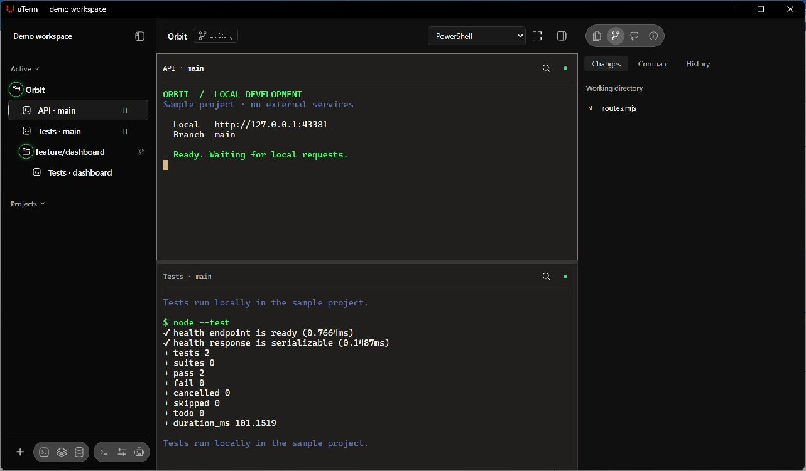

<p align="center">
  
</p>

# uTerm

**终端、Agent，回到项目里。**

面向 Windows 与 macOS 的项目式终端工作台，集中管理编程 Agent、Git
Worktree 与远程开发。让终端、代码、运行任务和数据连接，留在所属项目身边。

**[下载 uTerm](https://yondfane.github.io/uTerm/?lang=zh-CN#download)** ·
[探索官网](https://yondfane.github.io/uTerm/?lang=zh-CN) · [English](README.md) ·
[功能指南](docs/features.zh-CN.md)



_真实 Windows 工作区，使用临时示例项目和真实本地 Shell 会话。_

[下载](#下载) · [快速开始](#快速开始) · [工作流](#可以做什么) · [命令安装](#一行命令安装) ·
[开发](#开发) · [许可与反馈](#许可与反馈)

## 下载

| 你的设备            | 安装包                                                                        |
| ------------------- | ----------------------------------------------------------------------------- |
| Windows x64         | [Windows · .exe](https://yondfane.github.io/uTerm/?lang=zh-CN#download)       |
| macOS Apple Silicon | [Apple Silicon · .dmg](https://yondfane.github.io/uTerm/?lang=zh-CN#download) |
| macOS Intel         | [Intel · .dmg](https://yondfane.github.io/uTerm/?lang=zh-CN#download)         |

官网会查找最新稳定版中匹配的安装包，也可以在
[GitHub Releases](https://github.com/YondFane/uTerm/releases/latest)
手动选择。桌面安装包无需 Node.js 或 Rust；下载需要访问 GitHub。

macOS 安装包未经 Apple 公证，首次启动可能需要在**系统设置 → 隐私与安全**中批准。Windows 按安装向导提示操作。

## 快速开始

1. **添加项目**。打开 uTerm，选择**添加项目**并选取本地文件夹。已有 Git
   Worktree 会显示在所属项目下。
2. **打开会话**。启动终端，或在**设置 → Agent**中启用已安装的 Agent
   CLI。右击会话，选择**与……分组**，即可分屏工作。各 Agent CLI 使用自己的登录认证。
3. **运行与检查**。从项目菜单或工具栏打开 **Java 构建与运行**或
   **Python 运行**。在底部面板查看输出，在 **Git** 中检查代码变更。

退出应用会分离窗口，本地会话仍继续运行。再次打开即可重新连接；**关闭会话**才会终止所选进程。

Agent 的安装、配置、Hooks 和通知都在**设置 → Agent**中。参见
[Agent 配置](docs/features.zh-CN.md#agent-与设置)、 [TRAE CLI](docs/features.zh-CN.md#trae-cli) 和
[无需 Hooks 的通知](docs/features.zh-CN.md#无需-hooks-的通知)。

## 可以做什么

| 把工作放在一起   | 在 uTerm 中                                                                           |
| ---------------- | ------------------------------------------------------------------------------------- |
| **项目与 Agent** | 按工作区、项目和 Git Worktree 组织终端与 Agent，分屏处理并行任务。                    |
| **构建与运行**   | 用 Maven 构建 Java，运行 Java/Python 项目，查看可搜索日志，停止或重新启动任务。       |
| **文件与 Git**   | 查看差异与提交，编辑文件时保留冲突检查和草稿恢复，预览 Markdown 与 PDF。              |
| **远程与数据**   | 打开 SSH/SFTP，浏览 Redis，查询 MySQL、PostgreSQL、Oracle、Elasticsearch 和 MongoDB。 |

**Java 和 Python 保留各自的项目上下文**。切换项目时，对应配置和日志会一同切换。右击工具栏图标可选择已启动任务；侧栏彩色 Java/Python 图标标识正在运行的项目。

- **Java**：Maven 构建、Spring Boot 开发运行和 JAR 启动，按需安装完整 JDK 8/11/17/21 与 Maven。
  [Java 与 Maven 指南](docs/features.zh-CN.md#java-与-maven-构建)。
- **Python**：使用自己的 Python
  3 或虚拟环境，运行脚本、模块、FastAPI、Flask 和 Django。Python 与项目依赖需单独准备。[Python 与日志指南](docs/features.zh-CN.md#python-项目与日志)。

界面支持简体中文与英文、六种配色、可配置字体和快捷键。数据工具默认只读，按需开启受保护的编辑。SQL 与 MongoDB 需要 Java
17+ 和所选驱动，可在应用内按需管理；Elasticsearch 无需额外运行时。

使用方法、限制与平台验证详见[完整功能指南](docs/features.zh-CN.md)。

### 看看工作流程

[打开五步工作区导览](https://yondfane.github.io/uTerm/media/tour.html?lang=zh-CN) ·
[观看 30 秒导览](site/media/workflow.mp4)

导览为上方真实 Windows 截图添加标注，属于截图导览，并非连续录屏，不展示模型请求或远程服务器连接。
[素材说明](site/media/README.md)。

## 一行命令安装

macOS · 终端：

```sh
curl -fsSL https://raw.githubusercontent.com/YondFane/uTerm/release/scripts/install/install.sh | bash
```

Windows x64 · PowerShell：

```powershell
irm https://raw.githubusercontent.com/YondFane/uTerm/release/scripts/install/install.ps1 | iex
```

已安装 Node.js 22.13 或以上：

```sh
npx @yondfane/uterm-install
```

也可以使用 `pnpm dlx @yondfane/uterm-install` 启动桌面安装器。全局安装 npm 包只管理 `uterm-install`
命令，不会安装或卸载桌面应用。使用 `uterm-install --help` 查看选项。

macOS 脚本安装至
`~/Applications/uTerm.app`，无需 sudo，也不会自动启动应用。已有安装会被保留，请使用应用内更新。下载支持有限重试；稳定版源提供大小和 SHA-256 时可校验并复用缓存。
[安装器说明](docs/features.zh-CN.md#一行命令安装)。

## 开发

基于 **Tauri · React · TypeScript · Rust · xterm.js**，使用 WebGL 渲染终端。

环境配置、命令、仓库布局、验证和发布步骤见[开发指南](docs/development.zh-CN.md)。贡献时请遵循
[AGENTS.md](AGENTS.md)
和[文档编写规范](docs/writing-rules.md)，使用项目的Prettier/rustfmt，提交前运行 `pnpm format` 与
`pnpm format:check`。

## 许可与反馈

uTerm 按 [PolyForm Noncommercial License 1.0.0](LICENSE)
提供源码，在其允许范围内免费使用。超出许可已允许范围的商业用途需另行获得书面授权；条款和授权联系方式见
[NOTICE](NOTICE)。第三方组件保留各自许可。

[报告问题或提出功能建议](https://github.com/YondFane/uTerm/issues/new)，请附上操作系统、uTerm 版本及复现步骤。

macOS 原生客户端开发与稳定发布隔离。QA 应用、平台检查和分阶段功能状态见[原生迁移说明](docs/native-migration.md)。

共享核心检查使用 `pnpm test:core` 和 `pnpm contracts:check`；执行 `pnpm contracts:generate`
重新生成 TS／Swift 边界类型。macOS 上使用 `bash scripts/macos-native-build.sh` 和
`bash scripts/macos-native-test.sh` 构建隔离 QA 应用并运行 Rust／Swift 桥接测试。

原生终端 QA：`bash scripts/macos-terminal-smoke.sh`
使用临时数据及包内独立 helper，运行两个真实应用进程并保存双语／主题／宽度截图产物。SwiftPM 解析固定的 SwiftTerm
1.20.0 依赖，不改变旧终端渲染器。

共享核心检查会明确执行文件系统失败案例。Unix 需以普通用户运行以便目录权限生效；Windows 使用文件占用租约验证替换失败。

`uterm-core::{files,git,worktrees}`
管理本地文件及 Git／Worktree 规则和回归，Tauri 命令委派相同函数。新增 `git.*`
契约及生成 DTO 供隔离原生 QA 应用的**文件 →
Git…**使用，Core 现统一两端已登记项目的 Worktree 列表，原生侧栏支持选择、刷新及确认删除。Core 拒绝已保存／运行会话占用、脏文件和过期写入；Git 已删目录而元数据失败须明确刷新。两端使用 Core 收藏存储，核对 revision、保留准确旧来源并明确处理来源冲突；收藏恢复界面和平台验收仍待完成。`bash scripts/macos-git-smoke.sh`
使用临时仓库，检查真实窗口的差异／历史／复制、创建分支、编辑器冲突保护及真实 Worktree 菜单确认／取消／拒删／移除、收藏持久化及执行中取消保护，并保存系统截图；需要 macOS 图形会话，平台验收单独记录。核心锁定依赖包含现有 base64 解码器及遵循忽略规则的文件遍历器，原生文件／内容界面验收单独记录于迁移指南。

原生 QA 构建还执行
`pnpm build`，打包共用 Web 内容及许可声明；请先安装锁定的 pnpm 依赖。`bash scripts/macos-content-smoke.sh`
检查只读 CodeMirror／HTML／PDF 及资源边界。选择本地项目后，**文件 → 打开文件…**现通过共用编辑器及 Rust 草稿队列编辑文本。`bash scripts/macos-editor-smoke.sh`
检查真实原生编辑、草稿持久化后的 SIGKILL／重启、冲突／关闭／放弃／保存，生成报告和系统截图。此脚本需要 macOS 图形会话及隔离 QA
App，使用临时文件，不代表人工键盘／输入法验收；脚本也执行恢复选择、复制／恢复副本检查。

`pnpm qa:shared-state`
构建仅 QA 特性启用的隔离 Tauri 应用（`sh.uterm.desktop.qa.sharedstate`），在真实 WebView 中执行 Git／差异／历史／分支／Worktree 登记、编辑器导入／持久草稿／SIGKILL／重开／准确保存，以及状态保存／冲突／重载／退出／恢复场景。Windows／macOS
CI 截取原生窗口，并将报告及图片上传到
`legacy-checks-*/tauri-state-qa/`。此命令需要桌面会话，拒绝覆盖已有 QA 配置。专用配置路径链接将 QA 数据导向临时目录，不覆盖主目录变量，也不使用生产配置。自动化不代表人工键盘／输入法验收。

QA 还验证真实写入锁拒绝及明确重试恢复草稿，以及 Git 收藏预览／复制／过期／缺失恢复。Tauri 共用内容通过锁定的原生 clipboard-manager 插件复制，只给主窗口写文本权限，不依赖 WebView 剪贴板许可。Windows／macOS
QA 将完整原始来源与系统剪贴板核对，原生客户端使用限定范围的 NSPasteboard 调用。 JS 与 Rust 剪贴板插件须保持相同主／次版本，Tauri
CLI 会检查这组版本。

核心 `store/editor.rs`
管理核对 revision 的多文档草稿、准确旧来源副本及明确恢复。原生和 Tauri 编辑均通过
`src/lib/editor-drafts.ts`
的有界队列接入。Tauri 在 App 前初始化准确的带版本旧来源备份及明确迁移，冻结旧草稿键，并提供来源冲突／损坏副本恢复选择。原生标签／窗口顺序及完整编辑验收仍待完成，内容写入仅限所选文件。
`pnpm test:core`
明确执行工作区／草稿快照及 Worktree 删除后元数据及 Git 收藏保存／恢复的文件系统失败／重试检查。

共享回环控制服务位于
`crates/utermd-local/src/control/server.rs`，Tauri 与核心操作复用同一队列及生命周期；宿主为该服务直接声明 Tokio 和 tempfile。`pnpm test:host`
包含真实独立 CLI／socket 回归，`pnpm test:core`
检查桥接所有权及关闭；原生控制命令经共享 Rust 分发，其余原生能力继续开发中。

`pnpm test:legacy-host` 在隔离源码／目标目录中，从记录的 release
SHA 编译未修改的历史 helper，验证真实 PTY 回放、活跃进程保留及空闲升级。报告、源码／二进制摘要和日志写入
`ci-evidence/legacy-host/`，由 Windows／macOS
CI 上传；缺少基线时获取该提交，构建使用锁定依赖。这验证从历史源码编译的 helper，不代表已发布安装包升级验收。

macOS 可运行 `bash scripts/macos-control-smoke.sh`，使用真实包内 Rust
CLI、双 PTY、对话框保护及原生截图检查控制服务。在原生设置启用**允许本地 CLI 控制**，通过
`--control --data-dir PATH`
明确传入界面显示的数据目录；helper 默认配置仍指向旧客户端。Rust 使用锁定的 UUID 依赖分配 CLI 会话身份。QA 要求 WindowServer，不修改 URI 注册。
