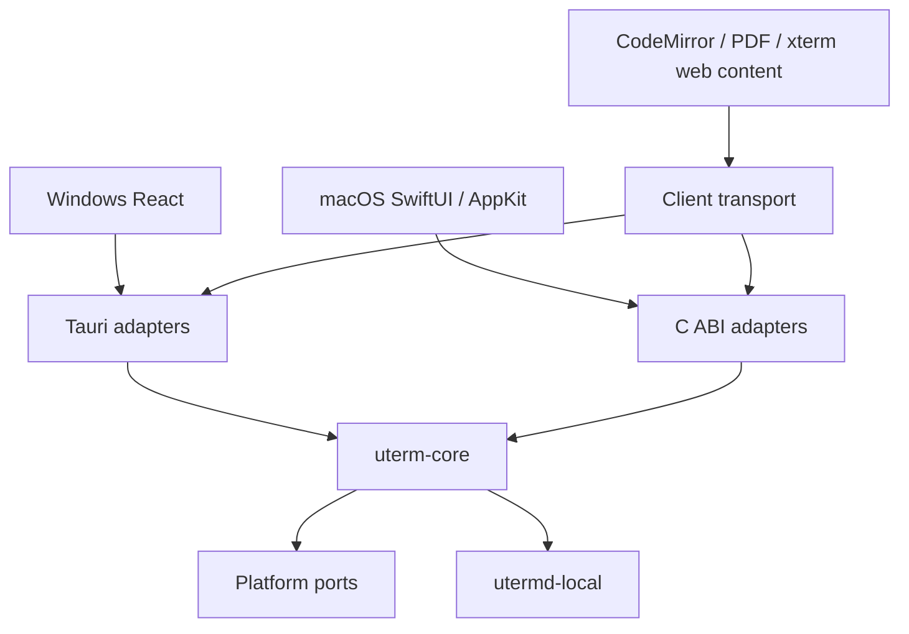

# Native clients and shared core / 原生客户端与共享核心

## Baseline and boundaries / 基线与边界

The migration branch starts at release `4f10848868ac09a3667e140938c345b265f9dd58`. Main
`0c6a7fee2eef238e72c9ecf34db99634f205d04c` has the same file tree and an additional merge commit. No
main-only code is imported. Application version stays 0.2.3; the existing macOS minimum is 14.0.
This work does not publish releases or modify stable updater feeds.

迁移分支基于上述 release 提交。main 仅多出合并历史，文件内容一致；未挑选其他代码。应用版本保持 0.2.3，macOS 最低版本保持 14.0。本任务不发布版本或修改稳定更新清单。

Core must not depend on Tauri, DOM, SwiftUI or AppKit. Window/menu/notification/file-picker adapters
stay in their client. The host remains a separate crate and process. Keep each Cargo manifest and
lockfile independent; no top-level workspace migration is intended.

核心不依赖 UI 框架；窗口、菜单、通知和选择器属于客户端适配。宿主保持独立 crate 和进程，各自 Cargo
manifest 与 lockfile 继续隔离。

## Capability ownership / 能力归属

| Capability / 能力                    | Existing owner / 现有归属                       | Migration boundary / 迁移边界                                     |
| ------------------------------------ | ----------------------------------------------- | ----------------------------------------------------------------- |
| Workspaces, projects / 工作区、项目  | `src/lib/workspace.ts`, App reducers            | Core validates and commits transitions; UI owns layout/focus      |
| Settings / 设置                      | `src/lib/settings.ts`, WebView storage          | Core validates and persists; client applies fonts/appearance      |
| PTY and replay / 终端与回放          | `crates/utermd-local`, Tauri session links      | Reuse host authentication, IDs, generation, sequence and ack      |
| Files and drafts / 文件与草稿        | Rust files service, CodeMirror, editor recovery | Shared root/conflict rules; reuse editor with transport           |
| Git / 版本控制                       | Rust Git service, React presentation            | Shared Git commands; native entry and shared content views        |
| SSH and SFTP / 远程连接              | Rust SSH/auth/tunnel services, host SSH PTY     | Shared authentication and transfers; platform credential port     |
| Java/Python tasks / 运行任务         | Rust launch services, host task pipeline        | Preserve task generations, final output and stop ownership        |
| Databases / 数据库                   | Rust database services, bundled Java engine     | Reuse workers and verified driver/runtime catalogs                |
| Redis / Redis 工作台                 | Rust client and protected mutation rules        | Shared guarded operations, credentials through platform port      |
| Agents / Agent                       | Host agents/hooks, Rust installation and usage  | Preserve commands, reporter paths and authentication              |
| Notifications / 通知                 | Shared activity, Tauri native dispatch          | Native client adapter, same state and deduplication semantics     |
| Menus, shortcuts, updates / 平台交互 | Tauri, TS view state, updater                   | Native AppKit/Sparkle candidate path; stable Tauri route retained |

This table is a migration target, not a claim that services already moved. The checked-in
`shared/contracts/tauri-baseline.json` inventories the baseline IPC names and storage declarations.

此表描述迁移职责，不表示已经迁移。基线 IPC 名称和存储声明见上述清单。

## Storage and process inventory / 存储与进程清单

| Store / 存储                   | Version, owner and semantics / 版本、所有者与语义                                                                                                                                                                |
| ------------------------------ | ---------------------------------------------------------------------------------------------------------------------------------------------------------------------------------------------------------------- |
| `uterm.desktop.workspace.v1`   | Workspace schema 7; TS imports schemas 3–6 with one-time backups; null selections and empty rosters remain meaningful                                                                                            |
| `uterm.desktop.settings.v1`    | Settings schema 1; TS fills only documented missing defaults, then validates                                                                                                                                     |
| `uterm.desktop.editorDraft.v1` | Editor recovery snapshot; invalid bytes retained under `.invalid`; save conflicts retain drafts                                                                                                                  |
| Other WebView keys / 其他键    | Notifications, Git favorites and version-scoped PDF marks; `.backup`, `.invalid` and workspace-version backup suffixes are retained. Fonts/panes are settings fields; database drafts remain client-owned memory |
| Rust app data / Rust 应用数据  | Java/Python configs, component catalogs, connection state and local control are rooted at the client's resolved app-data directory                                                                               |
| Credentials / 凭据             | macOS Keychain / Windows credential APIs; do not export secret values into workspace JSON, FFI events or CI artifacts                                                                                            |
| Host / 宿主                    | `local-daemon-v1` owns authenticated endpoint, session processes, bounded replay and task state; closing a client only detaches                                                                                  |

Production identity is `sh.uterm.desktop`; legacy development is `sh.uterm.desktop.dev`. Native QA
uses `sh.uterm.desktop.qa.native`, never adopts production storage or a production host, and does
not register `uterm://`. UI-only focus, temporary view selection and composition state remain client
owned. Persisted drafts and sessions cannot be replaced by an empty native view.

生产、旧开发和原生 QA 身份完全分离；QA 不接管生产存储、宿主或链接协议。临时焦点和输入法状态属于客户端，已有草稿与会话不能被原生空视图覆盖。

At the baseline, `Sessions::host_executable` staged the Tauri executable. The current implementation
uses `crates/uterm-core/src/host.rs` for staging and retains compatible active versions.
`crates/utermd-local/src/bin/utermd-local.rs` dispatches `--local-daemon`, `--local-task`,
`--agent-report`, SSH askpass and `--control`; the native package bundles this Rust executable, not
the Swift UI binary, as its helper. `daemon.rs`, `tasks.rs` and `activity_bridge.rs` retain PTY/task
lifetime, replay and hook ownership. Clients detach on quit; explicit session close terminates only
the specified generation.

基线使用 Tauri 程序作为宿主，当前由共享 Rust 模块暂存并保留兼容活跃版本。独立 helper 承担上述命令入口，Swift
UI 程序不作为 Rust 宿主。PTY、任务、回放及 hooks 保持既有归属，退出仅断连，明确关闭只终止指定 generation。

Concrete source boundaries are
`src-tauri/src/{files,git,ssh,ssh_auth,ssh_tunnels,java,python,database,redis}.rs`,
`src/lib/{workspace,settings,file-document,useFileDocument}.ts` and the corresponding React views.
`src/lib/shared-state.ts` exports the WebView-owned keys and freezes workspace/settings writes only
after successful import. `crates/uterm-core/src/store.rs` retains `legacy-original.json`,
`snapshot-v1.json` and up to eight `backups`; legacy `.backup`/`.invalid` and schema-version backups
remain in the original WebView storage. Editor draft recovery stays in `file-document.ts` until M3;
database edit drafts remain transient UI state.
`src-tauri/src/{ssh_auth,redis_credentials,database}.rs` handle credential adapters; credentials
must not be added to migrated JSON. The baseline inventory records exact IPC/storage source paths
and declaration lines without containing user data.

上述源码路径明确文件、Git、远程连接、任务与数据服务边界；WebView 导出后由共享存储保存原始数据、快照及备份。原 WebView 恢复键保留，编辑器草稿在 M3 前保持原路径，数据库编辑草稿仍为临时界面状态。凭据通过平台适配，不进入迁移 JSON；基线清单只记录源码声明，不含用户数据。

## Contract draft / 契约草案

- Versioned control envelopes carry an operation ID, method and parameters. Replies retain the ID
  and either a result or a structured error. Unknown versions/methods fail explicitly.
- Snapshot revisions detect stale writes; migration tokens detect re-entry. `null`, absent fields,
  empty strings and collections keep their existing meanings. Rust DTOs will generate TS/Swift
  boundary types and CI will check drift.
- Operations run off the UI thread. Cancellation targets an operation, not a session. Closing the
  client drains callbacks and detaches streams; only an explicit close-session request kills a PTY.
- Terminal output is a separate binary channel: original bytes, generation, sequence and ordered
  acknowledgement. Ack follows consumption; bounded replay/backpressure are not replaced with
  JSON/Base64. Late events must not update a different generation or newer snapshot.
- C ABI buffers have explicit lengths and one free function; callbacks document their thread and
  lifetime. Rust panics must be caught before the C boundary. Swift publishes state on its main
  actor.

控制消息带版本及操作 ID；错误、取消和关闭均有明确边界。快照 revision 保护写入，终端原始字节独立传输，不增加 Base64。C
ABI 明确所有权与回调线程，Rust panic 不跨语言，Swift 在主线程更新界面。

## Stage status and evidence / 阶段状态与证据

| Stage / 阶段 | Current state / 当前状态            | Evidence and next work / 证据与下一步                                                                                                                     |
| ------------ | ----------------------------------- | --------------------------------------------------------------------------------------------------------------------------------------------------------- |
| M0           | Accepted, unmerged / 已验收，未合并 | Both native architectures and legacy Tauri jobs passed                                                                                                    |
| M1           | Accepted / 已验收                   | Shared validation/storage/FFI, Tauri save/recovery and export evidence accepted at 56ce724; task branch only / 核心、保存恢复及导出证据已验收，尚未合入。 |
| M2           | In progress / 开发中                | Real host, shared session operations and native terminal in development / 真实宿主、共享会话操作及原生终端开发中                                          |
| M3           | In progress / 开发中                | Shared files and readonly Tauri/WK content integrated; editing/drafts and other workflows remain / 共用文件及只读内容已接入，编辑草稿和后续流程未完成。   |
| M4           | Pending / 待实现                    | Remaining capabilities, native interaction and measurements                                                                                               |
| M5           | Pending / 待实现                    | Candidate packaging, signed update and rollback exercises                                                                                                 |

Linux cloud has Node 26.13.0 and Rust 1.99.1, and has no Swift/Xcode or interactive Mac. The
baseline file tree passed 343 frontend tests (ten skipped), 59 host tests (three ignored), 150
backend tests (ten ignored), production and Linux desktop builds in the previous task. That evidence
is tied to the baseline tree, not new native code. M0 CI records PR head separately from the tested
merge SHA, macOS/Xcode/Swift versions, startup logs and the ad-hoc-signed QA App on Apple Silicon
and Intel. Native interaction and performance have not been measured. A graphical smoke is not human
acceptance.

云端不是 macOS。既有检查只证明基线文件树；原生代码必须经过新 CI。CI 区分 PR
head 与实际测试合并 SHA，并保存工具链、启动结果和 QA
App。原生交互及性能仍未测量，图形启动冒烟不等同人工验收。

### M0 evidence / M0 证据

Commit `3b362bd163d9bb5cec4336523f204b304b7df967` passed native workflow
[41389663733](https://github.com/YondFane/uTerm/actions/runs/41389663733) on ARM and Intel. Both
opened a visible window with one screen and exited with code 0. The tested merge SHA was
`7249babf2eb79bfca7bea7ed6a85190b1b3e2938`. Xcode 16.4/Swift 6.1.2 ran on macOS 15.8.2 ARM and
15.7.9 Intel. Legacy Tauri workflow
[41389663452](https://github.com/YondFane/uTerm/actions/runs/41389663452) passed macOS and Windows.

上述提交的两种原生架构均完成真实窗口启动并正常退出；旧 Tauri 的 macOS／Windows 检查也通过。源码 SHA、测试合并 SHA 与工具链分别记录；不代表人工交互或性能验收。

### M1 data and ABI / M1 数据与 ABI

The Tauri bootstrap imports normalized legacy workspace/settings and opaque raw auxiliary keys. Rust
owns schema 1, SHA-256 revisions, an exclusive writer lease, atomic replacement, the immutable
original export and eight prior snapshots. Re-import returns existing newer data for the same source
token; a different source fails. Corrupt data is never silently replaced. Recovery verifies the
current digest and backup digest and preserves damaged bytes. Writes complete before UI publication;
quit waits for the save queue. A stale writer must explicitly reload, retaining its draft.

Tauri 启动时导出规范化旧数据和原始辅助键，Rust 管理 schema、revision、单写者、原子写入及备份。重复迁移不会覆盖后续修改，损坏数据不会自动重置。恢复前核对当前及备份摘要并保留损坏字节；保存完成后才发布界面状态，退出等待队列。冲突需明确重载，草稿保留。

C ABI 1 uses borrowed input spans, owned async copies and allocation IDs for idempotent buffer
release. Worker replies and local snapshot invalidations retain operation IDs. Subscription
callbacks borrow bytes only for their invocation; synchronous events run on the calling thread.
Close drains operations and callbacks. Do not synchronously call, subscribe or close from a
callback; enqueue after return. Cancellation skips work not started and suppresses pending delivery;
it does not roll back a committed write or interrupt a callback already executing. Events are local
to the handle; external writers are detected by revision checks. Consumers reload the current
snapshot on invalidation instead of ordering hash strings. Terminal transport is not routed through
JSON FFI.

C
ABI 明确输入、异步副本、分配 ID 和回调生命周期，关闭等待操作与回调结束。回调内不能同步重入，应排队执行。取消不撤销已提交写入，也不打断正在执行的回调。事件仅作用于当前句柄，其他写者通过 revision 检测；收到失效事件后读取当前快照，不按哈希字符串排序。终端字节不通过 JSON
FFI。

Rust DTOs generate checked-in TS/Swift types with `pnpm contracts:generate`; CI runs
`pnpm contracts:check`. `pnpm test:core` exercises storage and C ABI. `tests/core-contract.test.mjs`
executes a real Rust process and compares legacy defaults, settings boundaries and selection/project
transitions. `scripts/macos-native-test.sh` links the Rust static library and exercises Swift calls,
events, stale writes and reopening. M1 native ARM/Intel CI passed for head
`4ffa97c08809a3761880b6374ccc5b8a58c1ccce`, tested merge `7a4fa0f0e87bea35f549e79a3ab21801c9807c78`:
[run 41393862162](https://github.com/YondFane/uTerm/actions/runs/41393862162). Artifacts:
[ARM](https://github.com/YondFane/uTerm/actions/runs/41393862162/artifacts/13118805408) and
[Intel](https://github.com/YondFane/uTerm/actions/runs/41393862162/artifacts/13118363170), named
`native-qa-macos-15-4ffa97c08809a3761880b6374ccc5b8a58c1ccce` and
`native-qa-macos-15-intel-4ffa97c08809a3761880b6374ccc5b8a58c1ccce`. Each contains toolchain,
core/FFI/Swift logs, window report and QA App. These M1 artifacts contain no terminal screenshots.
Legacy [run 41393862160](https://github.com/YondFane/uTerm/actions/runs/41393862160) passed both
platform jobs. Many existing session/layout reducers still live in TS; removal requires
corresponding shared operations and dual-client acceptance. Auxiliary drafts remain on their
original path until M3.

类型由 Rust
DTO 生成并检查漂移；兼容测试运行真实 Rust 进程。Swift 测试覆盖调用、事件、过期写入及重开，M1 双架构及旧客户端 CI 已通过上述对应 SHA；产物含报告和 QA
App，不含终端截图。会话／布局的既有 TS
reducer 尚未全部替代，必须补齐共享操作和双端验收后删除；辅助草稿在 M3 前继续使用原路径。

## Development commands / 开发命令

Linux M1 checks passed: ten storage tests, four C ABI tests, three real-process
compatibility/adapter tests, 345 existing frontend checks (ten skipped), 150 backend tests (ten
ignored), host tests, TypeScript, production and Linux desktop builds, formatting, translation
coverage and documentation checks. The full frontend run predates the third adapter test; that test
ran separately against the same application code. M1 macOS bridge and Windows automated checks
subsequently passed as linked above; native recovery interaction remains pending.

Linux 的上述检查使用临时目录和测试数据，没有接管真实会话。完整前端检查之后新增的第三项适配测试单独通过，应用代码一致。M1
macOS 桥接及 Windows 自动检查随后通过，原生恢复交互仍待验收。

On a Mac with Xcode 16.4 selected, run `bash scripts/macos-native-build.sh`, then
`bash scripts/macos-native-smoke.sh` from the repository. The latter requires an actual logged-in
GUI session and WindowServer and fails when unavailable. The QA binary opens an actual native
window, records visibility and screen information, requests normal termination, and the harness
verifies its exit code. It starts no host, loads no production data and has no simulated sessions.

在选定 Xcode
16.4 的 Mac 上运行上述脚本。启动冒烟要求真实图形会话，缺失时失败；程序创建实际窗口并正常退出，由脚本检查退出码。M0 不启动宿主、不读取生产数据、不构造虚假会话。

## Issue alignment / Issue 对齐

Continue branch `feat/native-macos-shared-core` and Draft PR
[#12](https://github.com/YondFane/uTerm/pull/12). Tracking
[#13](https://github.com/YondFane/uTerm/issues/13) and all acceptance criteria remain authoritative.
Do not merge, tag, publish or modify `release`/`main` directly. YondFane is the authenticated
executor; M0 evidence tasks #20–#23, M1 export task #28 and active M2 tasks #29–#32 have been
claimed. No project/status labels are invented.

沿用当前分支和 Draft
PR；总跟踪与原验收标准不变。本轮只认领实际处理的基线归档、旧格式验证与 M2 任务，不合并、不发版、不直接修改受保护目标分支。

| Stage / 阶段 | Issues / 任务 | Existing implementation and gaps / 既有实现与缺口                                                                                                                                                                                                                                                    |
| ------------ | ------------- | ---------------------------------------------------------------------------------------------------------------------------------------------------------------------------------------------------------------------------------------------------------------------------------------------------- |
| M0 #14       | #20–#23       | Accepted: #20–#23 completed, native screenshots and four CI jobs verified; not merged. / #20–#23 已验收关闭，真实截图及四个平台 CI 已核对，未合并。                                                                                                                                                  |
| M1 #15       | #24–#28       | Accepted: contract/store/FFI, Tauri save/recovery and export boundaries at 56ce724; all five tasks and stage closed. / 五项任务及阶段已验收，未合入 release。                                                                                                                                        |
| M2 #16       | #29–#32       | Active: shared host/helper, native shell, cached SwiftTerm views, binary sequence/ack and split/reconnect. Automatic native/legacy checks and system screenshots verified at 6c78229; full capability and manual acceptance remain. / 6c78229 的自动检查和系统截图已验证，完整功能与人工验收未闭合。 |
| M3 #17       | #33–#37       | Shared local files and scoped Tauri/WK content transport have real readonly text/HTML/PDF QA. Editing/drafts, Git, SSH and task services remain. / 共用文件与只读内容已自动验证，编辑草稿及后续服务未完成。                                                                                          |
| M4 #18       | #38–#43       | Basic native settings are partial groundwork only; full capability, interaction and measurement gates remain. / 基础原生设置仅为部分前置实现，完整功能、交互与测量未完成。                                                                                                                           |
| M5 #19       | #44–#47       | QA App is ad-hoc signed, not a release candidate acceptance. Signed updates, actual upgrade/rollback and formal signing/notarization remain. / QA App 临时签名不等于候选验收，更新、实际升级回退及正式签名公证待完成。                                                                               |

### M2 implementation and verification / M2 实现与验证

The following entries archive the initial M2 verification sequence. Current source-specific results
and superseding passes are collected in
[Current accepted baseline](#current-accepted-baseline--当前已验收基线).

以下按提交保留最初验证过程；当前结果及替代先前等待状态的通过证据见文末当前已验收基线。

The same Rust host broker and link registry now serve Tauri and the native bridge. The helper is
staged outside the read-only bundle by digest; active compatible hosts retain their executable. The
standalone executable also owns the existing control CLI entry. Shared session operations use the
canonical revision, including split layout, selection and removal. SwiftTerm 1.20.0 fits the
selected Xcode 16.4 toolchain; the current latest SwiftTerm requires a newer Swift tools version. No
renderer performance improvement is claimed.

Tauri 与原生桥接复用宿主管理和连接注册表。helper 按摘要暂存到包外，兼容的活动宿主保留原执行文件；独立程序复用 control
CLI。会话／分屏使用规范 revision。SwiftTerm 版本按工具链兼容选择，不宣称性能改善。

The native harness opens two real PTYs, verifies Unicode/ANSI and alternate-screen return, checks
cached view identity, hides/reopens the window, records language/theme/width screenshots, then
quits. A second process reconnects to the same generations, replays output and explicitly closes the
test sessions. All data lives under a private temporary QA root. Screenshots and reports are
uploaded by the native workflow, with source head and tested merge SHA in `toolchain.txt`. Until
that run passes, this is an implemented harness, not completed acceptance.

原生脚本实现真实双 PTY、视图保留、隐藏重开、双语／主题／宽度截图及第二进程重连关闭。数据隔离在临时 QA 目录，工作流上传截图、报告及两种 SHA；CI 实际通过前，不将脚本存在视为验收完成。

Rust and TypeScript share numeric fixtures covering 0, 2^53−1, 2^53, 2^53+1 and u64::MAX. Swift
checks exact `UInt64` decoding and decimal acknowledgement encoding. TypeScript currently rejects
unsafe values; full-range support is still open. Multi-client input/resize arbitration, manual input
methods, real Agent TUI, copy/paste, sleep and multiple displays remain acceptance gaps.

三种语言共用数值边界样例。Swift 需验证逐位精确解码／确认；TypeScript 超范围明确拒绝，完整范围支持仍开放。多客户端输入／尺寸仲裁及人工交互仍有缺口。

Local M2 validation on Linux x86_64 (Node 26.13.0, Rust 1.99.1) passed 347 frontend tests with ten
skipped, 148 backend tests with ten ignored (two terminal tests moved into the shared core), 16 core
tests and four FFI tests. Production build, generated-contract drift, formatting, i18n and
documentation checks passed. Host tests and Linux desktop compilation run separately; their logs
must be checked before recording success. Native Swift compilation and screenshots still await this
branch's new macOS CI.

本地上述结果只覆盖 Linux；迁移到共享核心的测试保留，未将数量减少解释为删减验收。宿主测试、新 control
CLI 测试及桌面编译也已通过，Swift 编译及截图待新 CI。

M2 head `9449c3e1881f28b5172ee8ebfef90fca26da447d`: legacy Windows/macOS
[41407004301](https://github.com/YondFane/uTerm/actions/runs/41407004301) passed. Native
[41407004364](https://github.com/YondFane/uTerm/actions/runs/41407004364) failed at Swift
compilation; its archived baseline/toolchain/dependency files are evidence of that failure, not
runtime screenshots. The next correction exposes the bridge error initializer, uses the SwiftTerm
delegate contract and observes window focus without overriding a non-open third-party method.
`Package.resolved` is taken from this real CI resolution and subsequent builds enforce it.

上述 M2 提交的旧客户端 CI 通过，原生编译失败，未执行原生运行。修复桥接访问权限、委托契约及焦点接入；依赖锁来自真实 CI，后续构建强制使用锁定版本。

Legacy CI retains its original `release` PR/push and manual triggers, commands and independent Cargo
workspaces. Its `legacy-checks-<runner>-<head>` artifact now collects source/toolchain records,
core/FFI/contract, host, frontend, backend, docs, formatting and desktop-build logs even on failure.
Explicit Bash steps retain pipe failure handling on both Windows and macOS. These artifacts prove
commands and compilation; they contain no native interaction screenshots or installer acceptance.

旧客户端 CI 保留原分支触发、命令及 Cargo 隔离；新增 artifacts 保存两种 SHA、工具链及各检查日志，失败也上传。Windows 与 macOS 使用显式 Bash 管道失败检查，报告不冒充原生交互或安装验收。

At head `1d54ee1d62892c29ac4392c76752960e9548b74e`, native ARM
[41408360042](https://github.com/YondFane/uTerm/actions/runs/41408360042) built successfully and
passed 16 core, four FFI and five Swift tests. The real window report records ready state and one
screen but the process timed out on termination: not a passed smoke. Termination is changed to
cancel the initial synchronous request, drain work asynchronously, then request final termination. A
timeout now captures a process sample before cleanup. Legacy Windows
[41408360035](https://github.com/YondFane/uTerm/actions/runs/41408360035) failed because the
existing slow-start fixture did not reach its ready marker; the next run bounds Rust test
parallelism to four without removing the responsiveness assertion. These failed runs remain part of
the evidence.

上述提交的 ARM 构建及核心／桥接测试通过，真实窗口可见但退出超时，不能标为 smoke 通过；修正退出流程并增加超时进程采样。Windows 既有慢启动样例未达到 ready，下一轮限定并发且保留响应性断言，保留失败证据。

### Export compatibility and recovery boundary / 导出兼容与恢复边界

`tests/core-contract.test.mjs` now sends legacy keys through a real Rust process, creates a split,
changes settings, exports current values and passes them into `readWorkspace`/`readSettings`. Both
reader source files are unchanged from `origin/release`;
`git diff --quiet origin/release -- src/lib/workspace.ts src/lib/settings.ts` confirms the target.
Four focused tests passed on Linux with
`node --experimental-strip-types --test tests/core-contract.test.mjs`. The new export case checks
IDs, layout, selection, settings, original draft/invalid/backup bytes and repeat import. Platform CI
for this added test is pending; its frontend log will be archived by the legacy workflow.

真实 Rust 导出已交给未修改的 release 读取器，本地四项专项检查通过；新增测试覆盖 ID、布局、选中项、设置、辅助恢复字节及重复导入。新增测试的平台结果待 CI，不沿用旧提交。

The data formats are canonical document schema 1 containing workspace schema 7 and settings schema
1; legacy export is `{revision, values}`, where each `values` entry is the original WebView key and
its string value. Workspace/settings strings reflect the current snapshot; auxiliary strings remain
unchanged. `shared/fixtures/legacy-state.json` provides repeatable normalized defaults without user
data. The process test constructs both old source values and an updated split/session example.

规范文档 schema 1 包含工作区 schema 7 与设置 schema 1；导出为
`{revision, values}`，values 保留键名和字符串值，主状态反映当前快照，辅助值保持原样。默认值及更新后分屏样例可由测试重复构造，不含用户数据。

For recovery, keep the original WebView data and the canonical directory (including
`legacy-original.json`, `snapshot-v1.json` and `snapshot-*.backup`) before attempting a client
replacement. Stop client writes and export the latest canonical state first; quitting detaches
rather than kills the host. Verify an exported JSON file with the old readers before using it in any
isolated old QA client. Restoring only an old executable does not restore post-migration settings or
drafts. An automatic WebView import or tested install-level downgrade is not supplied by this format
test; keep the prior data copy and use the current recovery UI if the snapshot is corrupt. Do not
overwrite the canonical copy or resume two authoritative clients during recovery. Credential stores
remain platform-owned and are not part of the JSON export. Actual installation replacement, host
retention and full data rollback remain #46; native recovery interaction and dependency acceptance
keep #28 open.

恢复前保留旧 WebView 数据及整个规范目录，停止客户端写入并导出最新状态；退出只断连宿主。导出先经旧读取器校验，再用于隔离旧 QA。仅替换旧程序不能恢复迁移后的设置或草稿。格式测试未提供自动 WebView 导入或安装级降级验收；保留先前副本，损坏快照使用当前恢复界面，不覆盖规范副本或同时运行两个权威写者。凭据仍由系统管理。实际安装替换、宿主保留和完整回退属于 #46；原生恢复及依赖未验收前 #28 保持开放。

### Auxiliary data ownership / 辅助数据归属

The first import archives all `uterm.*` source strings. Subsequent export refreshes workspace and
settings only. Auxiliary values in that export are the original imported bytes, not a live copy of
later WebView edits. Retain a fresh copy of the old WebView profile as well as the canonical store
before replacement. Native readonly content does not initialize, clear or migrate these keys.

首次导入归档全部 `uterm.*`
原始字符串；后续导出只刷新工作区和设置。辅助值仍为首次导入字节，不是后续 WebView 修改的实时副本。替换前需另存最新旧 WebView 配置及整个规范存储；原生只读内容不初始化、清空或迁移这些键。

| Data / 数据                                                   | Current writer / 当前写入方                                                                                                 | Remaining owner / 后续任务                                                                                              |
| ------------------------------------------------------------- | --------------------------------------------------------------------------------------------------------------------------- | ----------------------------------------------------------------------------------------------------------------------- |
| `uterm.desktop.editorDraft.v1`, `.invalid`, `.backup`         | `useFileDocument.ts` owns drafts/invalid; original backups stay opaque / 草稿和 invalid 由原模块管理，备份保留原样          | #34: versioned shared drafts, abnormal exit and restore / 版本化共享草稿、异常退出及恢复                                |
| `uterm.pdf.marks:<path>:<version>`                            | `PdfReader.tsx`, original WebView; native annotations disabled / 原 WebView，原生批注禁用                                   | #34: file identity and annotation preservation / 文件身份及批注保留                                                     |
| `uterm.git.favorites:<repository>`                            | `GitBranchTree.tsx`, original WebView / 原 WebView                                                                          | #35: Git preference migration / Git 偏好迁移                                                                            |
| `uterm.desktop.agentNotifications`                            | `AgentPanel.tsx`, original WebView / 原 WebView                                                                             | #40: native notification permission and preference / 原生通知权限及偏好                                                 |
| Workspace/settings version, `.backup` and `.invalid` suffixes | Original source archive plus existing readers; primary values use Rust snapshots / 原始归档及既有读取器，主值使用 Rust 快照 | #28 inventories and preserves bytes; #46 validates installation rollback / 本任务盘点保留字节，安装级回退由 #46 验证    |
| Session/layout reducers in `workspace.ts` and `App.tsx`       | Tauri adapters retain reducers; Rust serializes writes / Tauri 保留 reducer，Rust 串行保存                                  | #32 session/layout parity, #41 full settings, #46 shared installed-data adoption / 会话布局对齐、完整设置及安装数据接入 |
| Redis/database edit buffers, SQL and failed settings drafts   | Client memory, not WebView migration JSON / 客户端内存，不属于迁移 JSON                                                     | #38/#39 preserve connection/edit guards; #41 settings; #46 documents restart limits / 保留连接编辑保护、设置及重启边界  |
| Passwords, keys and credential references                     | Platform credential storage and validated connection references / 系统凭据存储及已校验连接引用                              | #36/#40 adapters, #46 verifies references without exporting secret values / 平台适配及不导出秘密的引用验收              |

### Recovering an unchanged old client / 恢复未修改的旧客户端

This is a recovery preparation procedure; installation/data write-back acceptance remains #46.

这是恢复准备步骤；安装及数据回写的实际验收仍属于 #46。

1. In isolated QA, finish or preserve unsaved work, then use **Settings → General → Export
   legacy-compatible data** for current canonical workspace/settings. Validate the exported strings
   with unchanged release readers, as the real-process contract test does.

   在隔离 QA 中完成或保留未保存工作，再从**设置 → 通用 → 导出旧版兼容数据**取得当前规范工作区／设置，像真实进程契约测试一样，交给未修改的 release 读取器校验。

2. Stop client writes and normally quit. Keep a fresh whole old WebView profile and canonical
   directory, including `legacy-original.json`, `snapshot-v1.json`, `snapshot-*.backup` and
   `.damaged` files. Export does not refresh later auxiliary edits. Do not terminate a live host
   merely to copy UI data.

   停止客户端写入并正常退出，备份整个最新旧 WebView 配置和规范目录，包括原始导出、当前快照、`snapshot-*.backup`
   和 `.damaged` 文件。导出不会刷新后续辅助修改；不要仅为复制界面数据终止活跃宿主。

3. With both clients stopped, restore the saved **pre-migration profile** only into a separate old
   QA installation. This restores the saved old state, not subsequent canonical changes. Keep the
   newer store untouched for returning to the new client.

   两客户端停止时，只把备份的**迁移前配置**恢复到独立旧 QA 安装。这恢复备份时的旧状态，不导入后续规范修改；保留新存储用于返回新客户端。

4. No automatic path writes the latest export into an unmodified old WebView. Actual installation
   replacement, complete data write-back, live host and credential reference retention must run in
   #46 before downgrade acceptance. Without an old QA installer/profile, retain backups and leave
   that gate pending.

   未提供将最新导出自动写回未修改旧 WebView 的入口。安装替换、完整数据回写、活跃宿主及凭据引用保留须在 #46 实际演练后才能宣称降级验收；缺少旧 QA 安装包／配置时保留备份，该门槛继续待验收。

Head `b57954302207490e0125d1e95023fa5edbe3318f` native ARM passed normal window termination, but
real PTY smoke failed while inspecting Unicode text. The QA text reader used raw cells, including
wide-character padding, and omitted SwiftTerm's combining-character provider. It now uses both
renderer APIs and a focused parser test covering color, Unicode, alternate screen and input-mode
toggles. This test does not establish actual IME, clipboard or mouse interaction. The smoke creates
a real temporary project, captures terminal diagnostics on failure and closes only its isolated host
sessions in cleanup. New native verification remains pending.

该提交的 ARM 退出冒烟已通过，真实 PTY
Unicode 检查失败；修正文本采集并增加解析器检查，不将模式解析当输入法／剪贴板／鼠标交互。脚本使用临时项目，失败记录终端诊断，结束清理自身隔离宿主，仍待新原生验证。

The Windows slow-start fixture failed again with bounded parallelism. The test now compiles a tiny
native disposable probe with the active Rust toolchain before measuring startup, avoiding a
PowerShell cold start inside the two-second capability-probe budget. It still opens an actual Agent
process, waits for the marker inside the five-second probe and checks concurrent HostStatus within
one second, then explicitly closes that generation. This fixture change needs Windows verification;
no production probe timeout or responsiveness assertion was relaxed.

Windows 在限定并发后仍复现同步失败；测试先编译小型原生探测样例，保留真实进程、慢探测、1 秒状态响应及明确关闭，不放宽生产超时或验收断言，等待 Windows 结果。

For #21 the existing empty-window smoke now also captures `native-empty-window.png`, stored next to
`native-smoke.json` with platform, architecture, OS and source head/tested merge metadata. It still
asserts a ready, visible, zero-session QA window with no host or production data access and a normal
exit. This capture must execute successfully on both native runners before screenshot acceptance.

#21 复用原空窗口 smoke 补充真实 PNG，与平台及两种 SHA 元数据共同归档；保留无宿主、无生产数据、零会话及正常退出断言，需双架构实际执行后验收。

At head `9e130a833cc0f773e6ac65d1846e57aa330eec03`, all six ARM Swift tests passed, including the
new renderer parser test. Window smoke then reported `coreReady: false` without an error: buffered
import invalidations could supersede the initial reload before it published any state. Startup now
loads the initial coherent snapshot before starting invalidation consumption, and stale reload
failures are ignored by epoch. Readiness is not established by an arbitrary delay. The correction
requires a fresh native run; the failed readiness report is retained.

该提交六项 ARM
Swift 测试通过，窗口报告暴露首个快照与缓存事件的初始化竞态；先加载一致快照再消费事件，并按 epoch 丢弃迟到错误，不以延时作为就绪条件，等待新原生运行。

Shared `host.close` now requires the caller's expected generation when a hosted entry exists;
missing or stale generations fail before terminating anything. Native close and isolated QA cleanup
send that identity. The real-host regression checks stale/null close preserves the live process,
then closes only the matched generation. Multi-client input/resize arbitration remains open.

共享关闭接口增加调用方 generation 校验；过期或缺失不终止任何进程。原生关闭和 QA 清理携带该身份，真实宿主测试先验证拒绝，再明确关闭匹配进程。多客户端输入／尺寸仲裁仍未完成。

Head `74e21811bb88e2491da1bbdea02b6c636b2952c0` failed Swift compilation because the new
empty-window capture referenced the bridge error without importing its module. The build pipeline
also lacked explicit outer pipe-failure propagation and therefore reached a later step after that
failure. The import is corrected and native job steps now explicitly use Bash with pipefail; a
failed build/test piped to a log must fail its own step. This run produced no valid new runtime
screenshots.

新增空窗口采集遗漏桥接模块导入，导致上述提交编译失败；外层日志管道未显式启用失败传播，错误延后才被发现。已补导入并为原生 job 使用显式 Bash/pipefail，失败必须在所属步骤报错；该轮没有有效新截图。

## Reusable acceptance checklist / 可复用验收清单

This is the M0 exit checklist for #23, not a claim that M3–M5 acceptance ran. Each result must
distinguish implemented, built, automatically tested and natively accepted. A missing condition is
recorded as not executed; a failed check remains failed. Only the documented M0 baseline is being
archived.

此节用于 #23 的 M0 退出清单，不表示 M3–M5 已执行验收。结果分别记录已实现、已构建、已自动测试和已原生验收；缺少条件写未执行，失败保留失败，仅归档已具证据的 M0 基线。

### Evidence record / 证据记录

Every report includes Issue, branch/PR, source head, tested merge SHA, platform/architecture/OS,
hardware, toolchain, dependency/CLI versions, command, scenario, test data/fixture hash, result and
remaining limitations. Link the actual workflow run and artifact name/ID; list screenshot filenames
and the action each proves. A screenshot's sidecar metadata must identify the same tested binary.
Never copy a prior head's success into a new head's result. Logs must omit credentials and endpoint
tokens. Record cleanup of only the temporary sessions, processes and data owned by the test.

每份报告记录 Issue、分支／PR、head／实际 merge
SHA、平台／架构／系统、硬件、工具链及依赖版本、命令、场景、样例摘要、结果和限制；链接真实 run 和 artifact，列出截图文件及对应操作。截图元数据必须对应相同程序，不沿用旧 SHA 结果。日志不含凭据或端点 token，记录自身临时会话／进程／数据的清理。

### Same-load comparison / 同负载对比

Compare legacy Tauri and native macOS on the same physical or CI machine, architecture, OS,
toolchain, selected shell, font (14pt), grid (120 columns × 36 rows), scrollback (3000) and
temporary project. Use separate QA identities/data roots. Run one client at a time, repeat each case
three times and retain individual results. A Windows run is its own regression record, not a direct
cross-OS performance comparison. Record shared-runner contention; do not infer a percentage gain
from build time or a single throughput sample.

在相同机器、架构、系统、工具链、Shell、14pt 字体、120×36 网格、3000 行回滚及临时项目下比较旧 Tauri 与原生 macOS，身份和数据隔离。每次只运行一个客户端，每例重复三次并保留单次结果。Windows 单独回归，不作跨系统性能结论；记录共享 runner 争用，不从构建时间或单次吞吐推断改善比例。

| Case / 场景                 | Reproducible workload and assertions / 可重复负载与断言                                                                                                                                                                                                     | Current acceptance / 当前验收                                                              |
| --------------------------- | ----------------------------------------------------------------------------------------------------------------------------------------------------------------------------------------------------------------------------------------------------------- | ------------------------------------------------------------------------------------------ |
| Idle / 空闲                 | 1, 4 and 16 real shell sessions; settle 30s, measure 60s. Record CPU, RSS and thread/FD or handle counts. / 真实会话静置 30 秒，测量 60 秒，记录 CPU、RSS、线程及资源句柄。                                                                                 | Not measured / 未测量                                                                      |
| Sustained output / 持续输出 | Same stored fixture of 10,000 numbered lines with ANSI color, CJK and combining characters; record exact bytes/hash, throughput and final screen. / 同一份一万行编号、颜色、中文及组合字符样例，记录字节、摘要、吞吐及最终屏幕。                            | Full client comparison not executed / 完整双端对比未执行                                   |
| Slow consumer / 慢消费      | Repeat with 200ms consumption delay, then a 5MiB burst; check sequence order, acknowledgement, bounded queues and explicit replay reset after history truncation. / 消费延迟 200 毫秒并追加 5MiB 突发，检查顺序、确认、有界队列及历史截断后的明确回放重置。 | Core one-frame backpressure tested; full stress remains / 核心逐帧背压已测，完整压力待执行 |
| Input / 输入                | After warm-up, 100 identical numbered echo operations; report p50/p95 input-to-render latency and the timestamp method. / 预热后发送 100 次相同编号回显，报告输入至渲染 p50／p95 及计时方法。                                                               | Not measured / 未测量                                                                      |
| Long run / 长时间运行       | 30min output and select/split/reconnect cycles; compare resource counts before/after closing test sessions and draining callbacks. / 30 分钟输出及选择／分屏／重连，关闭并排空后对比资源。                                                                  | Not executed / 未执行                                                                      |
| Content/data / 内容与数据   | Same temporary Git repository, 1MiB UTF-8 editor file, PDF, disposable DB result set and binary Redis keys; preserve read-only/conflict semantics. / 同一临时仓库、1MiB 文本、PDF、可丢弃数据库结果及二进制 Redis 键，保留只读／冲突语义。                  | Native adoption/credentials still incomplete / 原生接入及服务条件未齐                      |

For TUI compatibility, record exact `vim`, `less`, `tmux` and upstream Agent CLI versions. Use a
read-only copy of a UTF-8 test file in vim/less, two tmux panes and the same disposable Agent task.
Check cursor movement, color, alternate screen, resize, bracketed paste and mouse tracking against
the same expected output. Parser mode toggles are only parser evidence; they do not prove actual
clipboard, mouse, IME or authenticated Agent behavior. These TUI interactions are not executed yet.

TUI 记录 vim／less／tmux／上游 Agent
CLI 精确版本，使用同一只读 UTF-8 文件、两个 tmux 窗格和可丢弃 Agent 任务。检查光标、颜色、替代屏、尺寸、括号粘贴及鼠标。模式解析仅证明解析，不等同真实剪贴板、鼠标、输入法或认证 Agent；上述交互尚未执行。

### Native interaction steps / 原生交互步骤

| Area / 范围                      | Required actions and evidence / 操作与证据                                                                                                                                                                                                                     | Remaining condition / 剩余条件                                                                   |
| -------------------------------- | -------------------------------------------------------------------------------------------------------------------------------------------------------------------------------------------------------------------------------------------------------------- | ------------------------------------------------------------------------------------------------ |
| Text input / 文本输入            | Enter/commit/cancel Chinese composition, combining text, selection, copy and multiline bracketed paste; retain screenshot and recording where timing matters. / 中文组合输入提交／取消、组合字符、选中、复制及多行粘贴，保存截图，必要时录屏。                 | Operable Mac/tester; not executed / 可操作 Mac 或测试人员，未执行                                |
| Focus/layout / 焦点与布局        | Keyboard list navigation, focus return from settings/dialogs, split/drag/ungroup, narrow sidebar, full-screen transitions and traffic-light clearance. / 键盘列表、设置／弹窗返回、分屏拖动／解组、窄侧栏及全屏按钮避让。                                      | Automated scenes are partial; human acceptance pending / 自动场景部分覆盖，人工待验收            |
| Lifetime / 生命周期              | Hide/reopen, quit/relaunch with live processes, exact-generation close, disconnect/replay, sleep/wake and moving between two displays. / 隐藏重开、退出保活重连、精确 generation 关闭、断线回放、休眠唤醒及双屏移动。                                          | CI covers feasible cases only; sleep/multi-display pending / CI 仅覆盖可行部分，休眠／多屏待验收 |
| Save/recovery / 保存恢复         | Concurrent stale write, retained typed draft, explicit reload, IO failure, corrupt snapshot recovery and old-reader export. / 过期写入、保留草稿、明确重载、IO 失败、损坏恢复及旧格式读取。                                                                    | Core tests are not full native recovery interaction / 核心测试不代替完整原生恢复交互             |
| Files/remote/data / 文件远程数据 | Root escape/symlink rejection, external file conflict, SSH authentication/transfer cancel, binary Redis identity, DB read-only/confirmed write and quit protection. / 越界／符号链接、外部冲突、SSH 认证／取消、Redis 二进制及数据库只读／受控写入和退出保护。 | M3/M4 adoption and services required / 需要 M3／M4 接入及服务                                    |
| Windows / Windows                | Corresponding real isolated Tauri/WebView2 app scenarios with Windows shortcuts, paths, shell and process ownership; native screenshots separate from compilation logs. / 隔离真实应用验证 Windows 快捷键、路径、Shell 和进程所有权，原生截图与构建日志分开。  | Native interaction/screenshots still missing / 原生交互与截图仍缺失                              |

### External conditions and release boundary / 外部条件与发布边界

Only macOS CI is currently provided; no operable remote Mac or human tester is confirmed. GUI
automation must actually run with WindowServer and the necessary permissions; lack of permission is
not a passed test. CI log/artifact access is available to the authenticated YondFane account.
Artifacts have retention limits; save their actual names, links and checksums in Issue evidence.

当前仅提供 macOS
CI，未落实可操作远程 Mac 或测试人员。图形自动化需实际 WindowServer 和相应权限，缺权限不算通过。当前认证 YondFane 可读取 CI 日志和产物；产物有保留期限，Issue 记录真实名称、链接及摘要。

Current QA signing is ad-hoc (`codesign --sign -`). Formal Developer ID signing, hardened runtime,
notarization/stapling and an installable candidate require their actual certificates/authorization
and separate verification; their availability is not assumed from QA signing. Update verification
also needs isolated Tauri/Sparkle test feeds and test signing keys, wrong-architecture/signature,
interruption/retry and cancellation cases. Production feeds must remain untouched.

当前 QA 为 ad-hoc 签名；正式 Developer
ID、强化运行时、公证／装订及可安装候选需实际证书授权和独立验证，不能从临时签名推断条件齐备。更新还需隔离测试 feed／签名密钥及错误架构／签名、中断重试／取消场景，生产源保持不动。

Actual upgrade/rollback needs an old QA installer, the new isolated candidate, backed-up temporary
WebView/canonical/draft data and a live test host. Verify download, signature, replacement, first
start, repeated/interrupted import, preserved IDs/processes, credential references and data
rollback. The old-reader format test alone is insufficient. These are #44–#47 gates; no release, tag
or merge is implied. No manual owner, target date, credential or performance result is invented
here.

实际升级回退需旧 QA 安装包、新隔离候选、临时数据备份及活跃测试宿主，验证下载、签名、替换、首启、重复／中断迁移、进程／引用、凭据引用与数据回退。旧读取器格式测试不足以代替；这些属于 #44–#47，不授权合并、标签或发布，也不虚构人工负责人、日期、凭据或性能结果。

ARM native run [41411610700](https://github.com/YondFane/uTerm/actions/runs/41411610700) passed its
checks at head `cead13001c14010f242874566ca416c42c6c1691`, tested merge
`dd533886fb0f622094c74a1d1fd8c85037fb1eeb`. Its
[artifact 13125184346](https://github.com/YondFane/uTerm/actions/runs/41411610700/artifacts/13125184346)
contains all reports and 11 PNGs. Visual inspection found that the NSView cache method omitted
composited layers, especially the light terminal background/text. These are real view captures but
incomplete visual evidence, not accepted screenshots. Capture now uses `/usr/sbin/screencapture`
with the specific QA window ID, off the UI thread; it does not capture other windows or fall back to
incomplete rasterization if permissions fail. The new image method awaits actual CI and inspection.

上述 ARM 自动化通过并上传报告／11 张 PNG，但目视发现 NSView 缓存漏掉合成图层，浅色背景和文字不完整，不能作为通过截图。改用系统工具按 QA 窗口 ID 采集，失败不回退残缺图片，仍待新 CI 和检查。

## Current accepted baseline / 当前已验收基线

M0 tasks #20–#23 and stage #14 are completed, explicitly unmerged. Head
`6c782299f038fb2168b8d11123b3e3e7027123e6`, tested merge `8af10958a10d2924696272b9c8e1ed533127311e`,
passed native [41412826068](https://github.com/YondFane/uTerm/actions/runs/41412826068) and legacy
[41412826038](https://github.com/YondFane/uTerm/actions/runs/41412826038). This entry supersedes
pending statements for those earlier M0 checks; historical failed runs above remain tied to their
own SHAs. No older result is relabeled as this source's pass.

M0 任务与阶段均已验收关闭，明确未合并。上述同一 head／merge 的四个平台 job 全部通过，较早等待描述按其源码理解，失败记录保留，不把旧结果换名为新通过。

| Evidence / 证据             | Actual artifact / 实际产物                                                                                                                                               |
| --------------------------- | ------------------------------------------------------------------------------------------------------------------------------------------------------------------------ |
| Native ARM / 原生 ARM       | [13126042625](https://github.com/YondFane/uTerm/actions/runs/41412826068/artifacts/13126042625), `native-qa-macos-15-6c782299f038fb2168b8d11123b3e3e7027123e6`           |
| Native Intel / 原生 Intel   | [13125949025](https://github.com/YondFane/uTerm/actions/runs/41412826068/artifacts/13125949025), `native-qa-macos-15-intel-6c782299f038fb2168b8d11123b3e3e7027123e6`     |
| Legacy Windows / 旧 Windows | [13126372381](https://github.com/YondFane/uTerm/actions/runs/41412826038/artifacts/13126372381), `legacy-checks-windows-latest-6c782299f038fb2168b8d11123b3e3e7027123e6` |
| Legacy macOS / 旧 macOS     | [13126103232](https://github.com/YondFane/uTerm/actions/runs/41412826038/artifacts/13126103232), `legacy-checks-macos-latest-6c782299f038fb2168b8d11123b3e3e7027123e6`   |

Native ARM macOS 15.8.2 / Intel 15.7.9 used Xcode 16.4, Swift 6.1.2 and Rust 1.99.1. Both passed 16
core, four FFI and six Swift tests, zero-session visible window/normal exit, two real PTYs,
Unicode/ANSI/alternate-screen return, split/hide/reopen, language/theme/width/sidebars/full-screen,
detach/relaunch/replay retaining IDs/generations, explicit close and isolated idle-host shutdown.
All 11 ARM PNGs and Intel empty/narrow/wide/full-screen samples were visually inspected.
WindowServer captures include system buttons and complete light/dark compositing; older incomplete
NSView images are excluded. `terminal-live.json.sessionCount` records the initial zero-session
state; `splitSessionCount=2` records the result after creation, and the reconnect report proves
teardown.

两架构核心／桥接与实际窗口／终端自动场景通过，截图经上述范围目视核对；旧残缺图片排除。终端报告 sessionCount 为场景开始的 0，创建后的 splitSessionCount 为 2，重连报告验证最终关闭，不混淆生命周期阶段。

Legacy Windows Server 2025 x64 (10.0.26100) passed 347 frontend tests with 11 skipped and 142
backend checks with ten ignored. Legacy macOS ARM64 (Darwin 25.6.0) passed 348 frontend tests with
ten skipped and 148 backend checks with ten ignored. Both used Node 24.22.1, pnpm 11.22.0 and Rust
1.99.1; core/FFI/drift, real host/control, old-reader export, format/docs and desktop builds passed.
Skipped/ignored service fixtures and native interaction are not reported as passed. Earlier Linux QA
was exited normally and its dedicated display was stopped; no production host was touched.

旧客户端上述结果来自实际 CI 报告，跳过／忽略项不计通过；Linux 隔离 QA 已正常退出，仅停止自身显示进程，没有操作生产宿主。

M1 #24–#28 remain open for complete shared-boundary/failure-mode and native recovery acceptance. M2
#29–#32 remain open for complete native control integration, helper-version transition coverage,
keyboard/settings/real Agent TUI acceptance, full-range TypeScript sequence support, stress and
multi-client input/resize arbitration. Sleep, multi-display and macOS 14 runtime acceptance remain
unexecuted. M3–M5 capabilities, same-load performance, formal signing/notarization and actual
installation upgrade/rollback remain incomplete. PR #12 stays Draft and targets release; no merge,
direct release/main push, tag, Release or production feed change occurred.

M1／M2 的完整边界、失败模式、恢复交互、控制服务／宿主过渡、键盘设置／真实 Agent、TypeScript 完整范围、压力及多客户端仲裁仍开放；休眠、多屏与 macOS
14 运行未执行。M3–M5 接入、性能、签名公证及实际升级回退未完成。PR 保持 Draft，未合并、未直推 release/main、未打标签、未发布或改生产 feed。

### M1 recovery-copy integrity / M1 恢复副本完整性

Task #25 now rejects existing recovery/damaged paths whose bytes or file type differ. Recovery
listing verifies filename digests as well as document validation. Focused Linux tests passed for
occupied backup paths, valid-but-wrong backup content, preserved canonical bytes and retry. A real
read-only directory failure ran under UID 1000 and preserved snapshot/original import before retry.
`pnpm test:core` now explicitly includes this permission test; native CI records `core-io-test.log`.
Windows uses a held file handle to exercise atomic replacement failure; new platform CI is pending.

#25 校验已有副本的字节／文件类型及恢复列表摘要。本地普通用户已实际执行权限失败，验证快照／原始导出保留和重试；标准命令及原生 CI 明确执行该案例，Windows 占用文件替换失败仍待本次 CI，不把实现当作平台通过。

### Native sidebar callback boundary / 原生侧栏回调边界

For #30/#32 the sidebar now uses an AppKit table coordinator with an explicit update guard.
Programmatic row/selection synchronization cannot trigger core actions; user selections and focus
observation are deferred past delegate callbacks and rechecked. Pending user selection is preserved
until its revisioned operation finishes. The real two-process native smoke now fails on the known
NSTableView reentrancy diagnostic. Actual macOS build/run and image verification are pending for
this correction; the previous warning is not relabeled as fixed before execution.

#30／#32 新增明确的 AppKit 更新与用户操作边界，并在原生重连脚本中拒绝已知重入告警。待新 macOS 实际运行及截图检查后确认，不提前把旧警告标为已解决。

### Full-range terminal sequence / 完整范围终端序列

For #24/#31 Rust uint64 schema fields now generate TypeScript `bigint`. The terminal metadata
scanner preserves sequence integer tokens before JSON number conversion, respecting quoted strings
and escaped keys; Swift continues exact UInt64 decoding. Safe acknowledgements retain their old
numeric form, while larger values use decimal text validated by the same Rust parser in core and
Tauri. The host protocol and binary output bytes do not change. Shared fixtures cover the full u64
range; real-host tests acknowledge via decimal text. Missing/null/error contract tests preserve
snapshot and operation identity. Focused local tests and compilation passed; new platform CI is
pending.

#24／#31 由 Rust
schema 生成 bigint，并在 JSON 数值转换前保留精确 token；确认经兼容边界进入共用 Rust 校验，宿主协议不变。共用样例、真实宿主及契约失败模式验证已补齐，新平台结果仍待 CI。

### M1 binary callback lifetime / M1 二进制回调生命周期

For #26 the C ABI suite now attaches to a real temporary PTY helper, holds a binary callback active,
and concurrently unsubscribes or closes the handle. Both operations wait for callback completion
before its borrowed context is released. The callback verifies reentrant call, close and unsubscribe
rejection; the test also checks idempotent close and owns cleanup for the isolated host. Five C ABI
tests passed on Linux x86_64 with Rust 1.99.1 using
`cargo test --locked --manifest-path crates/uterm-ffi/Cargo.toml`. Fresh Windows and
dual-architecture macOS results are pending; existing platform passes do not validate this added
test.

#26 新增真实临时 PTY
helper 的二进制回调检查：回调执行时并发取消订阅或关闭，两者均等待回调结束后才允许释放借用上下文；同时验证回调内重入被拒绝和重复关闭，隔离宿主由测试清理。Linux
x86_64／Rust 1.99.1 的五项 C
ABI 测试通过；Windows 及 macOS 双架构的新结果仍待 CI，既有通过结果不替代本次新增测试。

### M2 native keyboard and Settings smoke / M2 原生键盘与设置 smoke

For #30/#32 the real application smoke now posts AppKit key-down/up events to the native sidebar,
switches to the split peer and back, and requires the table to retain first-responder status. It
opens Settings through the actual NSMenu action, captures the real sheet as `native-settings.png`,
and dismisses it with Return. The live report records these three assertions and eleven captures
(plus the separate empty-window image). Shell syntax and diff checks passed locally; actual Swift
build and WindowServer interaction await macOS CI. Manual IME/TUI/clipboard cases remain open.

#30／#32 的真实应用 smoke 新增 AppKit 按下／抬起事件，在两个分屏会话间切换并要求侧栏始终保留焦点；经实际 NSMenu 动作打开设置，截取真实设置 sheet，再用 Return 关闭。报告记录三个断言及十一张截图，另有独立空窗口图。本地仅通过 shell 语法和差异检查，实际 Swift 构建及 WindowServer 交互等待 macOS
CI；人工输入法／TUI／剪贴板仍未验收。

### M3 file-service adoption / M3 文件服务接入

For #34 the existing local file rules and thirteen regression tests move from the Tauri command
module into `uterm-core::files`; Tauri retains its public commands and OS-only menu/reveal/quit
adapters and calls this same implementation. Core `files.*` requests expose the service to #33, with
Rust-generated file DTOs for both languages. No editor reducer or draft is removed. Real process
tests cover BOM/CRLF, version conflicts and explicit overrides, read-only previews, path escape and
Windows junction/Unix symlink escape, plus malformed parameters. A newly exposed force-save path now
enforces the existing preview read-only rule in the core, preserving bytes. Linux checks passed;
fresh platform and native editor acceptance remain open.

#34 将原有本地文件规则和十三项回归迁至
`uterm-core::files`，Tauri 保留公开命令和系统菜单／显示文件／退出适配并调用同一实现。核心提供
`files.*`
请求和 Rust 生成的双端文件 DTO，供 #33 接入；未删除编辑器 reducer 或草稿。真实进程覆盖 BOM／CRLF、冲突与明确覆盖、只读预览、路径及 Windows
junction／Unix 符号链接越界、无效参数；核心同时阻止强制保存绕过既有只读预览规则。Linux 的完整前端 352 项通过／10 项跳过，核心／FFI、宿主、后端 135 项通过／10 项忽略、契约漂移、格式／文档、生产及桌面构建通过；新平台及原生编辑器验收仍开放。

### M3 scoped content protocol / M3 内容作用域协议

For #33 reusable file components and their document hook now call an allowlisted ContentScope. Tauri
adapts the existing commands; the JavaScript WKWebView adapter shares version/document/ operation
identity, errors and cancellation. Editor unmount closes its scope, and page unload closes the page
scope. Late responses and registrations cannot publish into a closed scope. Cancellation is delivery
cancellation, never a promise to roll back a committed file write. Six Linux protocol tests passed,
including bounds and malformed identity. The native WKWebView resource handler, navigation policy
and real integration are still pending, so #33 remains open.

#33 的复用文件组件和文档 hook 改由白名单 ContentScope 调用；Tauri 适配旧命令，JavaScript
WKWebView 适配共用版本／文档／操作身份、错误及取消格式。编辑器卸载与页面离开分别清理作用域，迟到响应／订阅不能更新已关闭的作用域。取消只抑制交付，不承诺撤销已提交写入。Linux 六项协议检查通过；原生资源 handler、导航策略和真实集成仍待实现，#33 保持开放。

### M3 native readonly content entry / M3 原生只读内容入口

For #33/#34 the QA native client now embeds the shared frontend in an ephemeral WKWebView. A bundle
manifest and resource handler restrict assets to approved immutable paths with file/size checks.
Only the main document can use the reply bridge, with a fresh nonce after navigation, bounded active
requests, cancellation and close cleanup. The selected project root is sealed; file rules still
execute in Rust. The native shell routes file-close actions to the focused content window and
disables terminal split/font actions while it is focused. Editing is not exposed before shared draft
recovery; backend file writes are denied for this preview.

The build includes shared assets and dependency license notices. The real app smoke checks UTF-8
CodeMirror, static HTML sandbox and generated PDF rendering, font persistence and rejected stale/
wrong-root/write requests, with three native captures and head/merge/platform metadata. This new
Swift/resource integration is pending its first macOS CI, not accepted from local web compilation.
Manual focus, editing/draft recovery and M2 stage dependency remain open.

#33／#34 原生 QA 以临时 WKWebView 嵌入共用前端；清单和资源 handler 限定包内路径、文件类型和大小，主文档桥接以导航后更新的 nonce 校验身份，限制并发并清理取消／关闭。项目根目录固定，文件规则仍由 Rust 执行；文件窗口关闭操作指向当前内容窗口，聚焦时禁用终端分屏／字号命令。共享草稿恢复未完成前不开放编辑，宿主明确拒绝预览中的文件写入。构建包含资源及依赖许可，真实应用 smoke 检查 UTF-8／HTML 沙箱／生成 PDF、字号保存及越界拒绝，保存三张原生截图和准确源码元数据。首次 macOS
CI 待执行，未以本地 Web 编译冒充原生验收；人工焦点、编辑／草稿及 M2 依赖仍开放。

Local verification for the native-content change passed on Linux x86_64: seven protocol checks, full
frontend 359 passed/10 skipped, types, production build, i18n, formatting and docs. Swift tests and
real native windows have not run locally; the native CI result remains pending. The readonly preview
also hides PDF annotation actions because its WebView store is ephemeral.

原生内容改动的 Linux
x86_64 检查通过：七项协议、完整前端 359 项通过／10 项跳过、类型、生产构建、翻译、格式与文档。本地未运行 Swift 或真实原生窗口，仍待原生 CI；临时 WebView 预览同时隐藏 PDF 标注操作。

### Native content first-run corrections / 原生内容首次运行修正

At head `2a4940127be364587c8fe2b3f2c90761270c3cb6`, tested merge
`55d05d206648258f43370f669e115d3c813bf0e7`, ARM passed eight Swift checks, readonly text/HTML, font
persistence and sandbox checks. The three rejection assertions failed because the smoke called a
callback API without awaiting its result; `56e573ec2107f25e73b2716596d7bd24954eb391` adds a
continuation and records actual codes without weakening assertions. Visual inspection found a PDF
error despite its canvas-allocation flag: the standard pdf.js build requires a Map API absent in
this WebKit. Renderer and worker now use the same pinned package's compatibility build, and the
smoke requires a completed render and no error alert. Fresh macOS CI is required for both fixes.

The failed
[ARM artifact](https://github.com/YondFane/uTerm/actions/runs/41430582363/artifacts/13133384997)
retains `content-live.json`, logs and three real WindowServer images. The PDF image is explicitly
failed evidence, not a successful native PDF acceptance. No Issue is closed from these results.

上述源码／测试合并 SHA 的 ARM 八项 Swift、只读文本／HTML、字号及沙箱检查通过；三个拒绝断言因回调结果等待错误失败，已以 continuation 修正并记录实际错误码。目视检查发现 PDF 图片有缺少 Map
API 的错误，不能以画布已创建宣称渲染成功；现改用同版本兼容构建并要求完成渲染且无错误，等待新 macOS
CI。失败 artifact 保留原报告、日志及三张系统图，PDF 图不计为通过，不据此关闭 Issue。

### M2 helper transition matrix / M2 helper 过渡矩阵

For #29 two additional real-process tests start the actual helper at its original path. An active
PTY retains PID/executable/generation and executes a liveness command; after explicit close the
broker safely replaces the idle host with its digest-staged executable, without changing source
bytes. Another test injects an incompatible endpoint version while retaining the real process and
checks that no endpoint overwrite or session termination occurs. The endpoint is restored before
cleanup, including failure paths; authentication bytes are not printed. This tests incompatible
advertised metadata, not a separately compiled historical protocol implementation.

Linux x86_64 / Rust 1.99.1 passed all three host tests and `pnpm test:core`, including FFI and the
explicit filesystem-failure case. New platform CI remains pending. Native control-service adoption,
full settings entry and the remaining compatibility matrix keep #29 open.

#29 新增两个真实进程检查：原路径活跃 helper 保持 PID／路径／generation 并执行存活命令；明确关闭后才将空闲宿主替换为摘要暂存副本，源字节不变。另注入不兼容端点版本，验证不覆盖端点或终止真实会话；清理前恢复端点，失败路径也不打印认证字节。该案例是不兼容元数据，非单独编译的历史协议实现。Linux
x86_64／Rust
1.99.1 三项宿主及完整 test:core 通过，新平台 CI 待执行；原生 control／完整设置入口和剩余矩阵继续保持 #29 开放。

### Native content accepted rendering and lifecycle follow-up / 原生内容渲染验收及生命周期补充

Head `b8c2459b2aa10354ab47e2a5f85f1715f790f483`, tested merge
`e4ca9a8371d01bf12ec4cb9cb5a7e0846e81b8d6`, passed native
[41432663064](https://github.com/YondFane/uTerm/actions/runs/41432663064) and legacy
[41432663047](https://github.com/YondFane/uTerm/actions/runs/41432663047). Both native reports
record all three actual rejection codes and completed PDF rendering. ARM content and Intel PDF
images were visually inspected and display expected text without the earlier error. Artifacts:
[ARM 13135332912](https://github.com/YondFane/uTerm/actions/runs/41432663064/artifacts/13135332912),
[Intel 13136295927](https://github.com/YondFane/uTerm/actions/runs/41432663064/artifacts/13136295927).

The next smoke uses the same content-window factory as the real file picker, reloads and rejects the
previous document identity, closes through the actual native menu and checks early close while
loading. Readonly close has a bounded fallback if Web content cannot reply. Shared settings window
effects now cross the host adapter boundary. These additions await fresh CI; editing/drafts, manual
focus and the M2 dependency still keep #33/#34 open.

上述 head／merge 的原生与旧客户端四 job 通过，双架构报告记录三个真实拒绝码及完成的 PDF 渲染；ARM 内容图及 Intel
PDF 图已目视确认无原错误。后续 smoke 与文件选择器共用窗口工厂，新增重载／旧身份拒绝、原生菜单关闭及加载中关闭，只读关闭在 Web 内容不能回复时有有界后备；共用设置的外观效果也进入平台适配。这些新增检查待新 CI，编辑／草稿、人工焦点及 M2 依赖仍使 #33／#34 保持开放。

The first #29 Windows matrix at head `3f34a3c611c118aa0df8c18e286af344c21f9abf` failed because
`current_exe` reports an ordinary drive path and `canonicalize` returns a verbatim path. The broker
now compares physical canonical paths, and the test additionally requires repeated idle access to
retain PID. Path checks normalize the actual file; active-host and endpoint assertions are retained.
Linux host checks pass; the Windows correction awaits a new run.

#29 首次 Windows 矩阵因普通／扩展盘符路径比较失败；现按规范文件路径核对，并新增重复访问空闲宿主保持 PID 的断言，不删除活跃保护或端点保留检查。Linux 宿主检查通过，Windows 修正待重跑。

### M1 save ordering / M1 保存顺序

#27 now has two real Rust-process regressions that first reproduced failures: a stale React settings
view reverted a committed font value, and quit resolved before a write enqueued during its wait.
Settings patches now use the initiating view's baseline; quit observes the queue until it stops
changing. Nine contract tests and the full frontend suite (361 passed, ten skipped),
types/production build and formatting pass on Linux x86_64. Native conflict/reload, failed draft and
recovery evidence remain pending, so #27 stays open.

#27 的两项真实 Rust 进程回归先复现了旧 React 设置视图还原已提交字号、退出早于等待期间新增写入结束的问题。现按发起视图基线计算补丁，退出持续等待队列稳定。Linux
x86_64 的九项契约测试、完整前端（361 通过／10 跳过）、类型／生产构建和格式通过。原生冲突重载、失败草稿及恢复证据仍待完成，#27 保持开放。

### M1 native Tauri QA / M1 原生 Tauri QA

#27 adds explicit reload/retry/discard. Failed setting patches remain in the provider, separate from
committed values, survive closing Settings and block quit even after reload. Per-field operation
tokens keep older failures from replacing newer results. Ten real Rust-process cases pass on Linux,
including same-field conflicts and delayed reloads serialized with writes.

`pnpm qa:shared-state` compiles the `qa` feature and QA-only frontend controller. It requires
`sh.uterm.desktop.qa.sharedstate` and a private temporary root, uses a real Tauri window and the
normal exit guard, and checks temporary project/default import, durable UI publication, external
conflict, retained same-field drafts, blocked quit, explicit reload/retry, reopen, corrupt-store
recovery and original/damaged-byte retention. Linux X11 ran these paths with dirty-source metadata;
committed Windows/macOS head/merge and native screenshots await fresh CI. DOM events drive the real
WebView; human input, IME and signing remain unexecuted. Existing TS reducers remain.

Pinned Tauri 2.11.6 has no newer directory-override API. QA links only its dedicated identifier
profiles into the private root, refuses existing profiles and unlinks only its own paths, without
changing HOME. Ordinary builds omit QA commands. Reports/screenshots go into
`ci-evidence/tauri-state-qa`, uploaded even on failure. The original Linux observer collided with
the writer lease; QA now waits for committed UI publication before reading, preserving production
locking and recording failures accurately.

#27 新增明确重载／重试／放弃；失败字段草稿与已提交设置分开，关闭设置后保留，重载后仍阻止未处理草稿退出。每字段操作标识防止旧失败覆盖较新结果。Linux 十项真实 Rust 进程案例通过，包含同字段冲突和延迟重载与写入串行。

上述 QA 命令以 `qa`
特性和仅 QA 前端控制器构建真实 Tauri 窗口，要求专用身份和临时根目录，使用正常退出保护，检查临时项目／默认导入、提交后界面、外部冲突、同字段草稿、阻止退出、明确重载重试、重开、损坏恢复及原始／损坏字节保留。Linux
X11 已跑通并标注工作区未提交状态；提交后 Windows／macOS
head／merge 和截图待新 CI。真实 WebView 由 DOM 事件驱动，人工输入、输入法和签名未执行，保留原 TS
reducer。

锁定的 Tauri
2.11.6 不支持新目录覆盖 API；QA 仅链接专用身份配置到临时根目录，拒绝已有配置，仅移除自己创建的链接，不覆盖 HOME。普通构建不编译 QA 命令；上述目录中的报告／截图失败也上传。早期 Linux 观察器与写入租约竞争；QA 改为先等待提交后的界面再读取，保留生产锁定规则并如实记录失败。

The helper correction passed head `ac682f21d955b137c277cda26bf2a90385f4cf54`, tested merge
`5037c127ad3fd7fd3bdeaa3937d048ac11acd47c`, in legacy run 41443585247 and native run 41443585262.
Windows artifact 13141981235 records all three actual host tests passing. #29 remains open for
control/capability work; a passing helper matrix does not complete that Issue. Current #27 frontend
checks pass 362 tests with ten skipped; backend passes 135 with ten ignored, and ordinary desktop,
production/types and formatting pass. Fresh platform QA is still pending.

上述 head／merge 的旧客户端及双架构原生 CI 已通过 helper 修正，Windows 产物记录三项真实宿主测试。#29 的 control／能力工作未完成。当前 #27 前端 362 项通过／10 跳过，后端 135 通过／10 忽略，普通桌面、生产／类型及格式通过；新平台 QA 仍待执行。

At head `b122b12b862a6730f16a9e8111be27a08b7b0de0`, legacy macOS QA job 125281707810
(run 41446766644) executed all storage scenarios, then failed removing a Saved State link already
removed by macOS (`ENOENT`). It is a failed job, not acceptance. Teardown now tolerates absent
links, refuses replaced non-links, records cleanup failures before writing the final report and
exits nonzero on failure. The corrected runner passes ten real cloud Linux X11 scenes with no
cleanup errors; fresh macOS/Windows results remain required.

上述 head 的旧 macOS QA 已执行全部存储场景，但系统先删除 Saved
State 链接，脚本清理时报 ENOENT，job 失败，不计验收。修正允许链接已不存在，拒绝删除被替换的普通路径，先记录清理错误再生成最终报告，清理失败也返回非零。新脚本在真实云端 Linux
X11 十个场景通过且无清理错误，仍需新 macOS／Windows 结果。

### Shared control service / 共享控制服务

#29 moves the existing Tauri listener/queue and its six protocol tests into
`utermd-local::control::Control`. Existing Tauri IPC names, disabled-by-default preference, private
endpoint, token authentication, loopback binding, request/connection limits, wake-before-check and
explicit reply semantics remain. The ownership wrapper stops and joins listener/client workers,
drains pending replies and releases its file lease without an Arc cycle. New `control.start`,
`status`, `configure`, `poll`, `reply` and `openLink` core operations expose the same service;
`Core::close` stops it. The native UI pump and toggle are not connected yet.

Linux tests execute the actual standalone helper CLI over its authenticated socket, preserve literal
Unicode/text and explicit Enter, dispatch a claimed request once, close with a pending client,
release the lease and reopen with the saved preference. A core integration test checks competing
handles, shutdown and ignored late replies. Native dispatch, complete capability negotiation and
fresh platform evidence remain #29 gates; no Issue is closed by this extraction. Host Cargo now
directly declares Tokio synchronization/time/runtime and tempfile already used by the Tauri server;
separate lockfiles retain their registry versions.

#29 将现有 Tauri 监听／队列及六项协议测试移入共享宿主，保留 IPC 名称、默认禁用、私有端点、认证 token、回环、有界请求／连接、登记后检查及明确回复语义。外层所有权对象停止并等待监听／客户端线程、排空请求并释放文件锁，无 Arc 循环。上述核心操作暴露同一服务，核心关闭时停止；原生 UI 轮询与开关尚未接入。

Linux 测试通过真实独立 helper
CLI 和认证 socket 验证 Unicode 字面输入、明确回车、认领只分发一次、等待客户端的关闭排空、占用锁释放及偏好重开；核心集成还检查竞争句柄和迟到回复。原生分发、完整能力协商及新平台证据仍是 #29 门槛，不因抽离关闭。宿主直接声明原 Tauri 服务已用的 Tokio 和 tempfile，独立锁文件保留既有版本。

M1 #27/#28 and stage #15 are now accepted at head `56ce724043d0ea4ebdf8a929aef76ecbc9c9e313`, tested
merge `e98be01cd195e6427c9824727a0221e596ea1132`. All four jobs in legacy run 41448284276 and native
run 41448284447 passed. Both legacy platforms supplied ten real window scenes and `passed=true`,
`sourceTreeDirty=false`, `cleanupErrors=[]` reports. Completed comments:
[#27](https://github.com/YondFane/uTerm/issues/27#issuecomment-6578004384),
[#28](https://github.com/YondFane/uTerm/issues/28#issuecomment-6578006321),
[M1](https://github.com/YondFane/uTerm/issues/15#issuecomment-6578009077). They are implemented and
accepted on the task branch, not merged into release; M2–M5 and #13 remain open.

M1 的上述源码／merge 在四 job 通过，两旧客户端各提供十张真实窗口图及成功、干净源码、无清理错误的报告。#27／#28 和阶段 #15 已按上述完成评论关闭，已实现并验收但未合入 release；M2–M5 及 #13 仍开放。

For the shared-control change, Linux passed core/FFI and host suites, 362 frontend tests with ten
skipped and the regular desktop build. Backend tests first hit three existing Git-discovery cases
because protected ancestor `.git` entries exist in `/tmp` and `/workspace`; rerunning unchanged
assertions with `TMPDIR=/var/tmp` passed 129 tests with ten ignored. Six protocol tests moved from
the backend into the shared host, accounting for its count change. The extended real Tauri QA now
enables/disables control through Settings and executes the actual CLI over the app's socket;
platform acceptance of that extension remains pending.

共享控制改动的 Linux 核心／FFI／宿主、前端 362 通过／10 跳过及普通桌面构建通过。后端先因
`/tmp`、`/workspace` 受保护祖先 `.git` 条目触发三项原 Git 发现问题；保持断言，用 `TMPDIR=/var/tmp`
重跑后 129 通过／10 忽略，六项协议测试移到共享宿主使计数变化。扩展真实 Tauri
QA 从设置启停控制并通过实际 CLI 调用应用 socket；该扩展的新平台验收仍待完成。

### Native CLI integration / 原生 CLI 接入

#29 exposes the control preference/data directory in native Settings and handles authenticated
requests through the existing bridge. Read-only status/list projections use the shared snapshot.
Rust owns new/focus/send/close rules, requires a live claimed request, rejects repeated execution,
checks revision, allocates a separate session UUID and pins input/close to the hosted generation.
CLI project-root creation clears a selected Worktree, matching legacy behavior. FFI emits the
committed revision. Closing cancels and awaits the control task before bridge shutdown; ownership
errors remain visible without disabling terminals.

Linux real-socket tests cover claimed/expired/repeated requests, stale revisions without creation,
project-path aliases and Worktree isolation. A real PTY test rejects stale-generation close without
removing configuration or stopping the process, then closes the matching generation. A C ABI test
checks committed revision events and service cleanup. Swift/UI execution requires fresh Mac CI.
`scripts/macos-control-smoke.sh` uses the bundled CLI for
status/projects/sessions/new/open/send/close, rejects modal writes, presses the native Settings
checkbox through `NSButton.performClick` and captures Settings plus terminal output. Dedicated
temporary projects/hosts are cleaned on success and failure. These are automated native actions, not
manual IME/clipboard/sleep acceptance.

Service extraction head `acb79d6a9329251250dc91599f80ba1b4dd48bfb` passed all four jobs in legacy
run 41452044182 and native run 41452044214. This validates the shared service and Tauri integration;
new native action code requires its own committed head evidence. #29/#30 and M2 stay open.

#29 在原生设置提供控制偏好／数据目录，经桥接处理认证请求；只读状态／列表由共享快照投影。Rust 负责创建／聚焦／输入／关闭，核对有效认领、单次执行、revision 和 generation，并分配独立会话 UUID。CLI 指向项目根目录时不继承 Worktree；FFI 发出已提交 revision。关闭前取消并等待控制任务结束，服务被占用时可见报错，终端仍可用。

Linux 真实 socket 测试覆盖认领／过期／重复、过期写入不创建会话、路径别名及 Worktree 隔离；真实 PTY 拒绝旧 generation 关闭且保留配置／进程，再关闭匹配代际；C
ABI 检查提交事件和服务清理。Swift／界面需新 Mac
CI。新脚本通过包内 CLI 检查上述命令、对话框保护、进程内原生 AppKit 复选框操作开关及设置／终端截图，成功失败均清理临时项目和宿主。不冒充人工输入法／剪贴板／休眠验收。

上述 acb79d6 的四 job 验证共享服务及 Tauri 集成，不能当作新原生命令代码的验收；#29／#30 及 M2 仍开放。

Head `e5af46b751dae3245ca4386fcef871e650b7bc23` built the native app on ARM/Intel but failed core
checks before native control smoke (native run 41459369581; legacy Mac run 41459369487). One test
reported WRITER_BUSY without its method, another never saw its socket request. Lock handling now
retries Interrupted while preserving other I/O failures and genuine contention; test diagnostics
include the method and an early client result. Assertions and five-second queue deadlines remain.
The cause is not declared resolved until fresh Mac execution passes.

上述 head 双原生构建通过，但核心测试先失败，不能算控制窗口验收。锁调用现重试 Interrupted，区分其他 I/O 与真实竞争；测试输出方法名及提前结束的客户端结果，保留原断言和五秒入队期限。需新 Mac 实际结果，尚不宣称原因已解决。

The diagnostic Intel run 41462738149 reached the real control window but could not find SwiftUI's
virtual accessibility node; its open sheet delayed termination. The preference now uses a native
AppKit checkbox, driven by `NSButton.performClick` in QA. Report completion dismisses QA sheets
before normal shutdown. Native screenshots and CLI acceptance for this correction remain pending;
the failed run's report and thread sample are retained in its uploaded artifact.

诊断运行 41462738149 的 Intel
job 已进入真实控制窗口，但找不到 SwiftUI 虚拟辅助功能节点；打开的 sheet 延后退出。本地控制偏好改用原生 AppKit 复选框，QA 通过
`NSButton.performClick` 执行正常操作；报告完成后先关闭 QA
sheet，再正常清理。此修正的原生截图与 CLI 验收仍待执行；失败运行已上传报告与线程采样。
