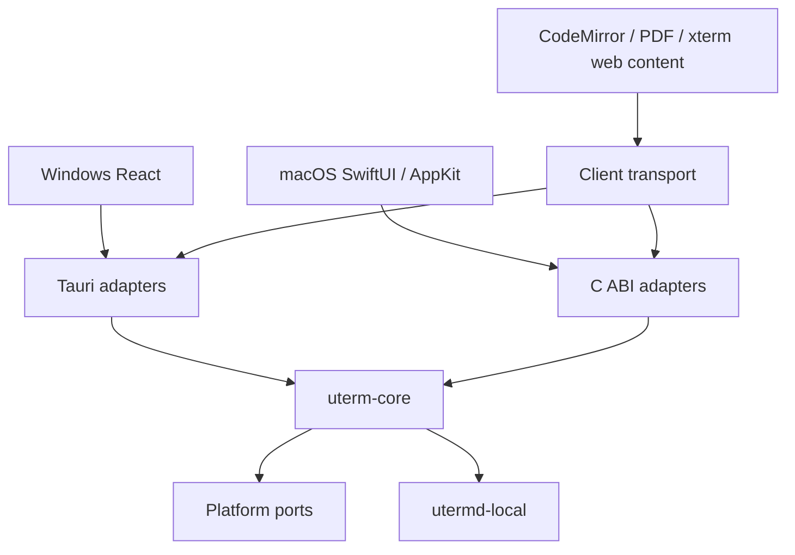

# Native clients and shared core / 原生客户端与共享核心

## Baseline and boundaries / 基线与边界

The migration branch starts at release `4f10848868ac09a3667e140938c345b265f9dd58`. Main
`0c6a7fee2eef238e72c9ecf34db99634f205d04c` has the same file tree and an additional merge commit. No
main-only code is imported. Application version stays 0.2.3; the existing macOS minimum is 14.0.
This work does not publish releases or modify stable updater feeds.

迁移分支基于上述 release 提交。main 仅多出合并历史，文件内容一致；未挑选其他代码。应用版本保持 0.2.3，macOS 最低版本保持 14.0。本任务不发布版本或修改稳定更新清单。

Core must not depend on Tauri, DOM, SwiftUI or AppKit. Window/menu/notification/file-picker adapters
stay in their client. The host remains a separate crate and process. Keep each Cargo manifest and
lockfile independent; no top-level workspace migration is intended.

核心不依赖 UI 框架；窗口、菜单、通知和选择器属于客户端适配。宿主保持独立 crate 和进程，各自 Cargo
manifest 与 lockfile 继续隔离。

## Capability ownership / 能力归属

| Capability / 能力                    | Existing owner / 现有归属                       | Migration boundary / 迁移边界                                     |
| ------------------------------------ | ----------------------------------------------- | ----------------------------------------------------------------- |
| Workspaces, projects / 工作区、项目  | `src/lib/workspace.ts`, App reducers            | Core validates and commits transitions; UI owns layout/focus      |
| Settings / 设置                      | `src/lib/settings.ts`, WebView storage          | Core validates and persists; client applies fonts/appearance      |
| PTY and replay / 终端与回放          | `crates/utermd-local`, Tauri session links      | Reuse host authentication, IDs, generation, sequence and ack      |
| Files and drafts / 文件与草稿        | Rust files service, CodeMirror, editor recovery | Shared root/conflict rules; reuse editor with transport           |
| Git / 版本控制                       | Rust Git service, React presentation            | Shared Git commands; native entry and shared content views        |
| SSH and SFTP / 远程连接              | Rust SSH/auth/tunnel services, host SSH PTY     | Shared authentication and transfers; platform credential port     |
| Java/Python tasks / 运行任务         | Rust launch services, host task pipeline        | Preserve task generations, final output and stop ownership        |
| Databases / 数据库                   | Rust database services, bundled Java engine     | Reuse workers and verified driver/runtime catalogs                |
| Redis / Redis 工作台                 | Rust client and protected mutation rules        | Shared guarded operations, credentials through platform port      |
| Agents / Agent                       | Host agents/hooks, Rust installation and usage  | Preserve commands, reporter paths and authentication              |
| Notifications / 通知                 | Shared activity, Tauri native dispatch          | Native client adapter, same state and deduplication semantics     |
| Menus, shortcuts, updates / 平台交互 | Tauri, TS view state, updater                   | Native AppKit/Sparkle candidate path; stable Tauri route retained |

This table is a migration target, not a claim that services already moved. The checked-in
`shared/contracts/tauri-baseline.json` inventories the baseline IPC names and storage declarations.

此表描述迁移职责，不表示已经迁移。基线 IPC 名称和存储声明见上述清单。

## Storage and process inventory / 存储与进程清单

| Store / 存储                   | Version, owner and semantics / 版本、所有者与语义                                                                                                                                                                |
| ------------------------------ | ---------------------------------------------------------------------------------------------------------------------------------------------------------------------------------------------------------------- |
| `uterm.desktop.workspace.v1`   | Workspace schema 7; TS imports schemas 3–6 with one-time backups; null selections and empty rosters remain meaningful                                                                                            |
| `uterm.desktop.settings.v1`    | Settings schema 1; TS fills only documented missing defaults, then validates                                                                                                                                     |
| `uterm.desktop.editorDraft.v1` | Editor recovery snapshot; invalid bytes retained under `.invalid`; save conflicts retain drafts                                                                                                                  |
| Other WebView keys / 其他键    | Notifications, Git favorites and version-scoped PDF marks; `.backup`, `.invalid` and workspace-version backup suffixes are retained. Fonts/panes are settings fields; database drafts remain client-owned memory |
| Rust app data / Rust 应用数据  | Java/Python configs, component catalogs, connection state and local control are rooted at the client's resolved app-data directory                                                                               |
| Credentials / 凭据             | macOS Keychain / Windows credential APIs; do not export secret values into workspace JSON, FFI events or CI artifacts                                                                                            |
| Host / 宿主                    | `local-daemon-v1` owns authenticated endpoint, session processes, bounded replay and task state; closing a client only detaches                                                                                  |

Production identity is `sh.uterm.desktop`; legacy development is `sh.uterm.desktop.dev`. Native QA
uses `sh.uterm.desktop.qa.native`, never adopts production storage or a production host, and does
not register `uterm://`. UI-only focus, temporary view selection and composition state remain client
owned. Persisted drafts and sessions cannot be replaced by an empty native view.

生产、旧开发和原生 QA 身份完全分离；QA 不接管生产存储、宿主或链接协议。临时焦点和输入法状态属于客户端，已有草稿与会话不能被原生空视图覆盖。

`Sessions::host_executable` currently stages the desktop executable and retains active versions. The
independent helper already supports `--local-daemon`, `--local-task`, `--agent-report` and SSH
askpass. Native adoption must also supply local control, preserve hook executable paths, stage and
sign helpers before launch, and leave a running host intact. A Swift executable cannot serve those
Rust command modes.

当前会话适配层暂存桌面可执行文件作为宿主，并保留活跃版本。独立 helper 已有上述入口；原生接入仍需补齐 control、保持 hooks 路径、正确暂存签名 helper，且不能替换正在承载会话的宿主。

## Contract draft / 契约草案

- Versioned control envelopes carry an operation ID, method and parameters. Replies retain the ID
  and either a result or a structured error. Unknown versions/methods fail explicitly.
- Snapshot revisions detect stale writes; migration tokens detect re-entry. `null`, absent fields,
  empty strings and collections keep their existing meanings. Rust DTOs will generate TS/Swift
  boundary types and CI will check drift.
- Operations run off the UI thread. Cancellation targets an operation, not a session. Closing the
  client drains callbacks and detaches streams; only an explicit close-session request kills a PTY.
- Terminal output is a separate binary channel: original bytes, generation, sequence and ordered
  acknowledgement. Ack follows consumption; bounded replay/backpressure are not replaced with
  JSON/Base64. Late events must not update a different generation or newer snapshot.
- C ABI buffers have explicit lengths and one free function; callbacks document their thread and
  lifetime. Rust panics must be caught before the C boundary. Swift publishes state on its main
  actor.

控制消息带版本及操作 ID；错误、取消和关闭均有明确边界。快照 revision 保护写入，终端原始字节独立传输，不增加 Base64。C
ABI 明确所有权与回调线程，Rust panic 不跨语言，Swift 在主线程更新界面。

## Stage status and evidence / 阶段状态与证据

| Stage / 阶段 | Current state / 当前状态                                                          | Evidence and next work / 证据与下一步                                                     |
| ------------ | --------------------------------------------------------------------------------- | ----------------------------------------------------------------------------------------- |
| M0           | CI verified / CI 已验证                                                           | Both native architectures and legacy Tauri jobs passed                                    |
| M1           | Implemented data path; platform verification pending / 数据通路已实现，待平台验证 | Shared validation, canonical storage, FFI, generated contracts and legacy client adoption |
| M2           | Pending / 待实现                                                                  | Real host/terminal/native shell; SwiftTerm compatibility gate                             |
| M3           | Pending / 待实现                                                                  | Files, Git, SSH and task workflows, one at a time                                         |
| M4           | Pending / 待实现                                                                  | Remaining capabilities, native interaction and measurements                               |
| M5           | Pending / 待实现                                                                  | Candidate packaging, signed update and rollback exercises                                 |

Linux cloud has Node 26.13.0 and Rust 1.99.1, and has no Swift/Xcode or interactive Mac. The
baseline file tree passed 343 frontend tests (ten skipped), 59 host tests (three ignored), 150
backend tests (ten ignored), production and Linux desktop builds in the previous task. That evidence
is tied to the baseline tree, not new native code. M0 CI records PR head separately from the tested
merge SHA, macOS/Xcode/Swift versions, startup logs and the ad-hoc-signed QA App on Apple Silicon
and Intel. Native interaction and performance have not been measured. A graphical smoke is not human
acceptance.

云端不是 macOS。既有检查只证明基线文件树；原生代码必须经过新 CI。CI 区分 PR
head 与实际测试合并 SHA，并保存工具链、启动结果和 QA
App。原生交互及性能仍未测量，图形启动冒烟不等同人工验收。

### M0 evidence / M0 证据

Commit `3b362bd163d9bb5cec4336523f204b304b7df967` passed native workflow
[41389663733](https://github.com/YondFane/uTerm/actions/runs/41389663733) on ARM and Intel. Both
opened a visible window with one screen and exited with code 0. The tested merge SHA was
`7249babf2eb79bfca7bea7ed6a85190b1b3e2938`. Xcode 16.4/Swift 6.1.2 ran on macOS 15.8.2 ARM and
15.7.9 Intel. Legacy Tauri workflow
[41389663452](https://github.com/YondFane/uTerm/actions/runs/41389663452) passed macOS and Windows.

上述提交的两种原生架构均完成真实窗口启动并正常退出；旧 Tauri 的 macOS／Windows 检查也通过。源码 SHA、测试合并 SHA 与工具链分别记录；不代表人工交互或性能验收。

### M1 data and ABI / M1 数据与 ABI

The Tauri bootstrap imports normalized legacy workspace/settings and opaque raw auxiliary keys. Rust
owns schema 1, SHA-256 revisions, an exclusive writer lease, atomic replacement, the immutable
original export and eight prior snapshots. Re-import returns existing newer data for the same source
token; a different source fails. Corrupt data is never silently replaced. Recovery verifies the
current digest and backup digest and preserves damaged bytes. Writes complete before UI publication;
quit waits for the save queue. A stale writer must explicitly reload, retaining its draft.

Tauri 启动时导出规范化旧数据和原始辅助键，Rust 管理 schema、revision、单写者、原子写入及备份。重复迁移不会覆盖后续修改，损坏数据不会自动重置。恢复前核对当前及备份摘要并保留损坏字节；保存完成后才发布界面状态，退出等待队列。冲突需明确重载，草稿保留。

C ABI 1 uses borrowed input spans, owned async copies and allocation IDs for idempotent buffer
release. Worker replies and local snapshot invalidations retain operation IDs. Subscription
callbacks borrow bytes only for their invocation; synchronous events run on the calling thread.
Close drains operations and callbacks. Do not synchronously call, subscribe or close from a
callback; enqueue after return. Cancellation skips work not started and suppresses pending delivery;
it does not roll back a committed write or interrupt a callback already executing. Events are local
to the handle; external writers are detected by revision checks. Consumers reload the current
snapshot on invalidation instead of ordering hash strings. Terminal transport is not routed through
JSON FFI.

C
ABI 明确输入、异步副本、分配 ID 和回调生命周期，关闭等待操作与回调结束。回调内不能同步重入，应排队执行。取消不撤销已提交写入，也不打断正在执行的回调。事件仅作用于当前句柄，其他写者通过 revision 检测；收到失效事件后读取当前快照，不按哈希字符串排序。终端字节不通过 JSON
FFI。

Rust DTOs generate checked-in TS/Swift types with `pnpm contracts:generate`; CI runs
`pnpm contracts:check`. `pnpm test:core` exercises storage and C ABI. `tests/core-contract.test.mjs`
executes a real Rust process and compares legacy defaults, settings boundaries and selection/project
transitions. `scripts/macos-native-test.sh` links the Rust static library and exercises Swift calls,
events, stale writes and reopening. Linux has no Swift compiler; macOS results remain pending for
this stage. Many existing session/layout reducers still live in TS; removal requires corresponding
shared operations and dual-client acceptance. Auxiliary drafts remain on their original path until
M3.

类型由 Rust
DTO 生成并检查漂移；兼容测试运行真实 Rust 进程。Swift 测试覆盖调用、事件、过期写入及重开，但本阶段 macOS 结果尚待 CI。会话／布局的既有 TS
reducer 尚未全部替代，必须补齐共享操作和双端验收后删除；辅助草稿在 M3 前继续使用原路径。

## Development commands / 开发命令

Linux M1 checks passed: ten storage tests, four C ABI tests, three real-process
compatibility/adapter tests, 345 existing frontend checks (ten skipped), 150 backend tests (ten
ignored), host tests, TypeScript, production and Linux desktop builds, formatting, translation
coverage and documentation checks. The full frontend run predates the third adapter test; that test
ran separately against the same application code. macOS bridge/UI validation and Windows runtime
evidence remain pending.

Linux 的上述检查使用临时目录和测试数据，没有接管真实会话。完整前端检查之后新增的第三项适配测试单独通过，应用代码一致。本阶段 macOS 桥接／界面与 Windows 运行证据仍待 CI／验收。

On a Mac with Xcode 16.4 selected, run `bash scripts/macos-native-build.sh`, then
`bash scripts/macos-native-smoke.sh` from the repository. The latter requires an actual logged-in
GUI session and WindowServer and fails when unavailable. The QA binary opens an actual native
window, records visibility and screen information, requests normal termination, and the harness
verifies its exit code. It starts no host, loads no production data and has no simulated sessions.

在选定 Xcode
16.4 的 Mac 上运行上述脚本。启动冒烟要求真实图形会话，缺失时失败；程序创建实际窗口并正常退出，由脚本检查退出码。M0 不启动宿主、不读取生产数据、不构造虚假会话。
